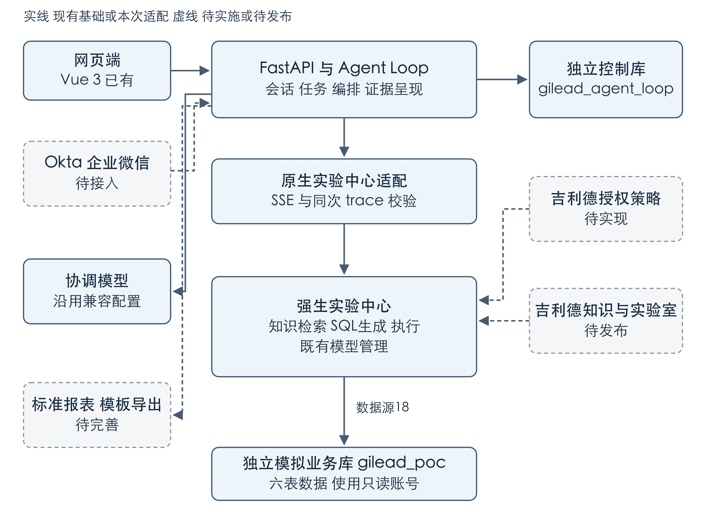
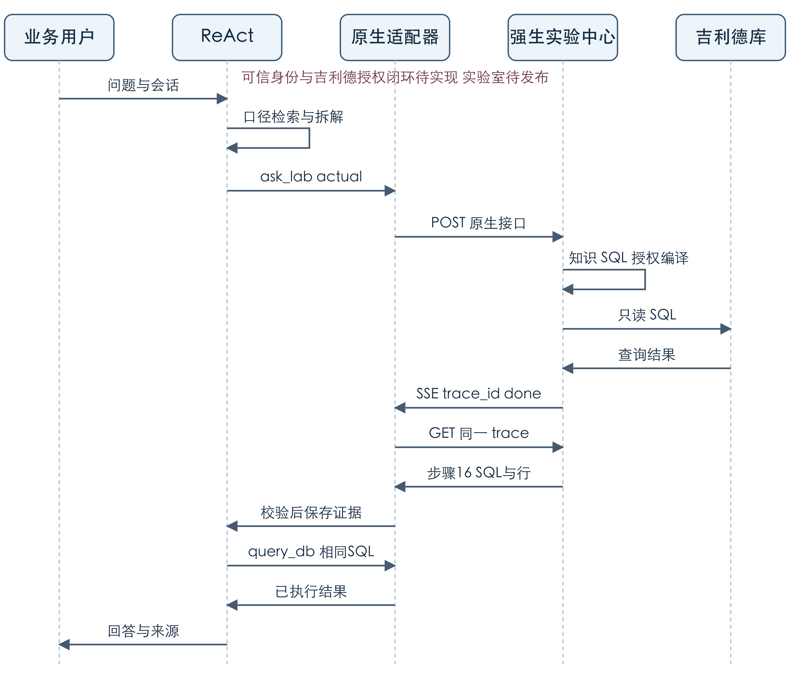
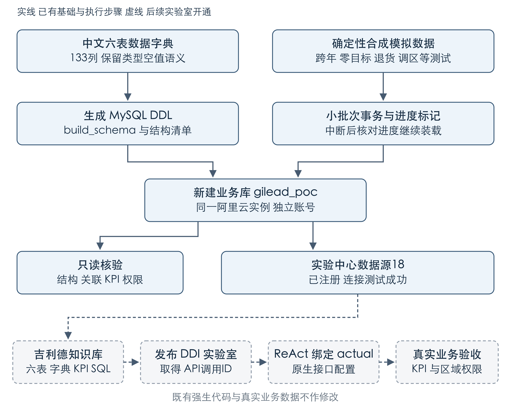

# 吉利德 AI4BI POC 架构与实施方案

编制日期：2026年10月22日。版本：1.0。适用对象：业务负责人、项目负责人和研发团队。

本方案采用当前 ReAct 代码副本，连接强生项目既有实验中心，在同一阿里云 MySQL 实例中建立吉利德独立模拟业务库和独立运行控制库。先验证 DDI 核心指标和查询证据链，再完成区域授权、标准报表和双渠道能力。生产部署目标仍按 RFP 使用吉利德中国 Azure 环境。

本次交付包括代码分支、六表模拟数据、强生原生接口适配、中文设计、图源和验收清单。完整业务系统按实施阶段继续建设。原强生项目代码不作修改；吉利德适配只发生在本目录副本中。

| 项目 | 当前结论 |
| --- | --- |
| 代码 | ReAct 独立副本，分支 jilide-poc，保留来源历史及复制时的工作目录改动 |
| 业务数据库 | 阿里云 MySQL 8.0.36，独立库 gilead_poc，六表共 133 列 |
| 运行数据库 | 同实例独立库 gilead_agent_loop，保存用户、会话、任务、审计和配置 |
| 实验中心 | 复用强生原生实验中心，吉利德数据源 18 已注册且连接测试通过 |
| 实验室 | 吉利德知识库和实验室尚待发布，取得独立 API 调用 ID 后绑定 |
| 数据 | 合成模拟数据，最新 DDI 日期 2026-09-03，最近完整月 202608 |
| 权限 | 数据库只读隔离已配置，吉利德终端用户区域授权闭环仍待实现 |

阅读顺序：先看需求与架构，再看数据和指标，最后核对实施阶段、32 项需求矩阵及验收交接。所有“待实施”均为后续工作，不作为已通过的验收项。

<!-- page -->
## 1 需求理解与功能范围

RFP 定义平台、DDI 用例、托管和服务要求；补充材料明确标准 DDI 报表、报表访问权限、销售区域权限及核心指标；数据字典给出六表及关联规则。补充截图用于理解报表形态，最终布局和品牌规范仍由业务确认。

| 功能组 | 需要提供的能力 | 实施顺序 |
| --- | --- | --- |
| DDI 分析 | 数量和金额实际与目标、达成率、月同比、QTD 同比、YTD 同比、上季度环比；按品牌、区域、HCO、渠道和时间筛选 | P0 |
| 报表与访问 | 标准 DDI 报表；角色控制能否打开；区域控制能看到哪些数据；表格、图表、文字和导出一致 | P0 |
| 查询可信性 | 原子问题、SQL 与结果证据、数据截止日、期间和币种标识、异常与无数据解释 | P0 |
| 基础使用体验 | 会话和追问、敏感词引导、用户名水印、吉利德页面风格、图表切换 | P1 |
| 管理与扩展 | 上传数据建主题、独立知识配置、推荐问题、反馈、复用技能、用量与访问审计 | P1 |
| 渠道与运行 | Okta、企业微信、更新通知、模板 Excel PDF PPT、缓存、Azure 部署、升级及知识转移 | P1 至 P2 |

P0、P1、P2 仅代表建设顺序，RFP 的 32 项要求均保留。现有 ReAct 已有网页会话、持久化任务、事件流、模型与数据源管理、知识检索、基础 Excel 导出和运行记录；这些是可复用基础，不能等同于完成吉利德验收。

业务负责人需要确认日度目标折算、环比的部分期间规则、覆盖系数用途、角色名称映射和报表布局。当前方案提供可执行的默认演示口径，并保留这些业务决策。

<!-- page -->
## 2 总体架构



实线表示现有基础或本次适配，灰色虚线表示待实施或待发布。原生接口适配已通过契约测试，真实吉利德实验室尚未发布。图中业务数据装载与最终核验以随附验证报告为准。

ReAct 负责会话、问题拆解、工具调度、任务恢复和结果呈现；实验中心负责独立知识配置、SQL 生成和执行。新建控制库与业务库分离，业务连接使用六表只读账号。主协调模型沿用 ReAct 兼容配置，实验中心内部模型继续由平台管理，本次不新增百炼直连接口。

采用模块化现有应用，避免在 POC 阶段拆出额外微服务。部署成本较低，但需要为实验中心超时、共享实例连接数和外部依赖设置明确边界。未来 Azure 迁移通过外置配置和容器镜像完成，业务接口不依赖当前公网地址。

<!-- page -->
## 3 业务问答与执行证据链路



原生 SSE 包含 trace_id、summary 和 done；summary 是生成文字。适配器只读取同一 trace 的步骤 16 中实际执行的 SQL、列和行，并校验请求问题、trace、成功状态及结果形状。query_db 消费这一 SQL 的执行证据，不再转到原项目数据库重新查询。

缺少 done、trace 串线、查询报错、跳过执行、SQL 不匹配和结果超限均拒绝作为数值依据。用户可见的过程应是数据来源、筛选条件、SQL、执行状态和解释摘要，不展示模型内部隐式推理或凭证。

图中的可信身份与吉利德授权编译是目标链路，需要在真实实验室验收前实现。当前协议适配测试不证明已完成终端用户区域隔离。

<!-- page -->
## 4 数据准备与实验室开通链路



数据源 18 已由强生平台正式数据源 API 注册，连接测试返回成功；没有复制强生真实数据。后续实验室可直接选择此数据源及六张表，并导入本项目的中文字段说明、KPI 口径和经验证的 SQL 示例。

发布时必须创建独立的吉利德知识库和实验室，取得自己的 API 调用 ID。数据源 ID 18、实验室数值主键和 API 调用 ID 是三个不同标识。当前不借用强生实验室 ID，也不把接口契约测试当作真实实验室联通。

实验室发布后，在 ReAct“强生实验中心”配置页绑定内部兼容域 actual。demand、ext_simple、ext_complex 在本 POC 不配置，吉利德知识索引只指向 DDI 主题。随后以金标准问题验证 SQL、结果、图表和导出。

<!-- page -->
## 5 六表模型与模拟数据

| 表名 | 列数 | 模拟行数 | 使用规则 |
| --- | ---: | ---: | --- |
| sales_target_ai4bi | 34 | 101400 | 月份 HCO 品牌和粒度的实际目标事实，Daily 与 Monthly 分开 |
| v_ai4bi_ddi_sales | 38 | 234480 | 日交易明细，sales_id 不唯一，按产品桥确定品牌 |
| prod_master | 28 | 16 | 16 个产品对应 13 个品牌及 6 个 TA，品牌关联先去重 |
| teri_hierachy | 27 | 131760 | 月份 HCO TA BU 快照，包含未来月份 |
| ddi_coverage | 4 | 11 | 11 个品牌的覆盖参数，允许大于一及未匹配品牌 |
| data_range_config | 2 | 1 | 最近完整月 202608，最新 DDI 日期 2026-09-03 |

六张业务表合计 467668 行。另有 _poc_seed_runs 辅助表记录种子版本及小批次装载进度，不向实验室账号授权。业务表维持原有列、空值语义及名称拼写，不擅自为 sales_id 增加唯一约束。

模拟数据覆盖 120 个 HCO、6 个大区、12 个省份和城市、6 个 TA、2 个 BU；日交易从 2024-01-01 延伸至 2026-09-03，月度数据截至 202608，层级快照覆盖 202101 至 203603。保留退货、零目标、零基期、品牌覆盖缺失、覆盖率大于一和跨区域调整场景。所有客户、人员、产品名称均为模拟标识。

原字典的 public 前缀表示源结构；在 MySQL 使用当前库。numeric 映射为 DECIMAL，year_month 裸标识符使用反引号。源数据示例的行数与日期不是本 POC 装载数量；为了验证同比，模拟日明细主动扩展到跨年区间。

<!-- page -->
## 6 核心指标与期间口径

| 指标 | 计算与处理 |
| --- | --- |
| 数量实际与目标 | SUM(sales_qty) 与 SUM(target_qty) |
| 人民币实际与目标 | SUM(sales_amt) 与 SUM(target_amt) |
| ASP 美元实际与目标 | SUM(sales_amt_asp) 与 SUM(target_amt_asp)，按既有 ASP 字段计算 |
| 数量达成率 | SUM(sales_qty) ÷ NULLIF(SUM(target_qty),0) |
| 金额达成率 | SUM(sales_amt) ÷ NULLIF(SUM(target_amt),0)，ASP 口径对应替换字段 |
| 同比或环比 | 当前期间值减可比基期值后除以基期值；基期为零返回不适用 |
| 日明细金额 | 人民币 SUM(sales_qty×price_latest)；美元 SUM(sales_qty×asp_price) |

补充材料的“指标 数量 金额”按销售目标理解，与“实际”和“达成率”构成报表指标组。该命名需业务确认。默认用最近完整月，不以电脑日期决定数据期间。

演示口径：月同比比较 202608 与 202508；QTD 同比比较 202607 至 202608 与 202507 至 202508；YTD 同比比较 202601 至 202608 与 202501 至 202508；上季度环比比较最近完整季度 2026 年第二季度与第一季度。若选择未结束季度，需明确等长期间规则，不能直接比较部分季度与完整季度。

目标为零和基期为零分别显示不适用，不能写成 0%。退货保留负数；无数据与实际为零分别呈现。先汇总再除，不平均行级百分比。DDI 的覆盖系数不自动裁剪或用于销量外推。模拟 ASP 价格按固定规则构造，仅用于可复现测试，不代表真实汇率。

Daily 是截至版本日的日交易汇总视图；历史月份可能与 Monthly 重叠，任何查询必须显式选择一种粒度。日目标是否按天折算、同比遇闰年如何对齐和币种展示单位，在正式口径签字时确认。

<!-- page -->
## 7 金标准与数据质量验收

下表为独立种子汇总的人民币金额金标准，金额单位元。落库后由只读 SQL 再计算并逐项比较，不能只验证 SQL 能执行。

| 场景 | 本期金额 | 基期金额 | 增长率 |
| --- | ---: | ---: | ---: |
| 202608 月同比 | 29579422.00 | 25881259.00 | 14.2890% |
| 2026 年 QTD 同比 | 62854721.00 | 55459232.00 | 13.3350% |
| 2026 年 YTD 同比 | 246387595.00 | 217379040.00 | 13.3447% |
| 最近完整季度环比 | 90504834.00 | 93028040.00 | -2.7123% |

核验脚本同时核对数量、人民币、ASP 金额及对应三类目标，保留完整 DECIMAL 精度；展示时才四舍五入。seed-manifest.json 保存期间、精确总数、版本和结构摘要，verification.json 保存实际数据库检查结果。

| 风险场景 | 验收方法 |
| --- | --- |
| 日月重复 | Monthly 查询不得混入 Daily；日交易金额与 Daily 汇总对账 |
| 多对多膨胀 | 产品按 CODI 编码关联，品牌先去重；层级按月份 HCO TA BU 连接，孤立关系为零 |
| 业务主键误用 | 验证 sales_id 存在重复；不得因其重复丢弃合法明细 |
| 覆盖参数 | 两个品牌无覆盖值且一个系数大于一，按缺失和原值分别展示 |
| 边界值 | 零目标和零基期返回不适用，负增长与退货保留，空集不伪造零 |
| 授权快照 | 模拟 HCO 在 202601 调区，历史归属和当前授权分别验证，禁止取未来最大月份 |

数据库核验结论以报告状态为准。金标准精确对账覆盖数据层；真实问答准确率、区域隔离和报表输出仍需实验室发布后测试。

<!-- page -->
## 8 区域授权与报表权限设计

报表权限分两层：角色或用户组决定能否打开 DDI 主题及标准报表；数据授权决定可访问的 HCO TA BU 组合。网页、企业微信、表格、图表、文字、导出和技能重跑使用同一授权范围。

建议链路：Okta 身份映射内部用户，服务端读取经批准的角色与生效授权快照，编译逻辑数据集 sales_target 的授权 CTE，再执行只读查询。对日明细使用 affiliate_hco_code 联合产品 TA 和 BU 限定范围。不得把用户问题里的姓名、前端传入的区域或可伪造身份头当作授权凭据。

当前强生原生网关使用 X-User-Id 与 X-Space-Id，既有通道默认用户不等价于吉利德终端用户 SSO。已有权限编译框架包含强生业务规则，必须新增 Gilead DDI 策略和身份映射，不能直接宣称已自动支持吉利德六表。

| 控制点 | 目标设计与验收 |
| --- | --- |
| 身份可信 | 服务端验证令牌和用户，跨渠道身份一致；缺失、过期或未映射时拒绝访问 |
| 主题可见性 | 无主题或报表授权时，列表、直达链接和 API 均不可调用 |
| 行级范围 | 授权元组保留 HCO TA BU 组合，避免独立 IN 列表产生权限笛卡尔积 |
| 月份语义 | 业务归属按业务月份；授权按批准的当前生效快照，不取未来月份；两者分开 |
| 结果与缓存 | 所有输出共享已授权结果；缓存包含用户、授权版本、数据版本和筛选条件 |
| 导出和技能 | 下载时重新鉴权；技能保存步骤参数，每次运行重新授权，不保存越权结果 |

当前六表只读账号解决数据库访问边界，仍可读模拟库全量，不构成用户级区域隔离。MySQL 不使用 PostgreSQL 的 RLS 策略实现方式。SAM 对 ASM、RD 对 RSM 等组织名称关系需业务批准后映射。

<!-- page -->
## 9 强生原生接口适配

POST /api/autobi/gateway/v2/lab 的请求包含 content、id 和 features。id 填吉利德实验室发布后的 API 调用 ID。适配器读取 SSE，要求唯一有效 trace_id 和结束事件，然后 GET /api/autobi/lab/traces/{trace_id}，从 data 封装内读取同一请求的执行记录。

```json
{
  "content": "查询2026年8月销售金额及同比",
  "id": "<吉利德API调用ID>",
  "features": {}
}
```

步骤 16 必须存在且成功，request.sql 是最终实际执行语句，response 包含 columns、rows 及截断状态。步骤 15 的候选 SQL 和步骤 17 的生成解释不能替代执行结果。query_db 仅接受同次运行已缓存的相同 SQL，任务恢复时保存并校验来源。

| 失败类型 | 处理 |
| --- | --- |
| 网络或超时 | 返回可重试的受控错误，不回退到旧业务库或演示数据 |
| 未结束或 trace 不一致 | 拒绝证据，要求重新发起查询 |
| 查询错误或跳过 | 不显示成功数值；不把 summary 中的数字当结果 |
| 多实验室同 SQL 来源冲突 | 标记歧义，不复用不确定结果 |
| 响应超限或截断 | 超限拒绝；截断明确标识，不能声称已获得全量明细 |

已增加原生适配契约测试，覆盖成功执行、缓存恢复、改 SQL 拒绝、错误 trace、错误问题、查询错误、跳过、缺失步骤、错误行形状和不完整事件流。真实吉利德端到端测试需要独立实验室发布后执行。

<!-- page -->
## 10 模块改造与实施阶段

| 阶段 | 主要工作与位置 | 完成标准 |
| --- | --- | --- |
| 基础准备 | deploy/gilead_poc 的结构、种子、装载、核验；新运行配置；原生 lab_http 适配；knowledge_gilead | 新库与专用账号、数据对账、测试、数据源连接均有证据 |
| M1 实验室联调 | 强生平台新知识库和 DDI 实验室；ReAct lab_connection 与 actual 绑定 | 独立 API 调用 ID，核心 KPI 问题取得真实 trace 且金标准一致 |
| M2 授权和标准报表 | 新增 Gilead DDI 授权编译、可信身份上下文、报表 API 与统一结果模型 | 不同区域同问题返回正确不同结果；全部输出反向测试无泄漏 |
| M3 产品能力 | DDI 页面、图表切换、敏感词、水印、推荐反馈、技能和模板输出 | 用户场景及管理员场景分别通过，数值与权限不随视图变化 |
| M4 渠道与生产 | Okta、企业微信、通知、Azure 镜像、私网、监控、备份恢复、培训 | SIT UAT 签字，运维演练、回滚和交接完成 |

先完成一条标准问题到报表的完整链路，再扩充复杂分析。M1 仅限模拟数据的管理员联调，区域用户试用以 M2 授权测试通过为门槛。功能实现前将每项验收案例关联 RFP 编号，避免只完成聊天入口而遗漏授权、导出或运营。

排期建议以依赖为门槛：M1 在实验室配置、模型和网络齐备后开展；M2 依赖用户及区域授权样本；M4 依赖吉利德 Okta、企业微信及 Azure 资源。详细人天和承诺日期需按人员及接入条件估算。RFP 中的 10月26日提交、26至27日演示、30日结果公布是采购节点，不代表生产系统已具备交付周期。

本次不修改强生原代码来增加接口，适配保持在吉利德 ReAct 副本。后续业务策略也优先使用独立吉利德配置；如果现有配置无法承载，应先在吉利德独立模块或环境验证替代方案。授权必须发生在 SQL 执行前，不允许通过执行后过滤聚合结果来模拟权限。

<!-- page -->
## 11 部署运维与关键决策

| 决策 | 采用方案与取舍 |
| --- | --- |
| ADR 001 复用现有应用 | 保留 Vue FastAPI 持久化 Agent Loop，减少 POC 新服务；需要补齐吉利德权限和渠道 |
| ADR 002 MySQL 双库 | 使用同一既有 RDS 的独立业务和控制库，账号分权；共享资源需限制并发，生产迁移另行验证 |
| ADR 003 原生实验中心 | 采用 SSE 加匹配 trace 的执行证据，避免修改强生代码；依赖 trace 结构，需契约回归 |
| ADR 004 独立知识与实验室 | 使用数据源 18 和独立发布 ID，避免混用旧主题；发布和联调是上线前置条件 |
| ADR 005 统一授权结果 | 服务端授权后统一派生视图和导出；实现复杂度高于仅过滤页面，但符合 RFP 一致性要求 |

本地启动脚本 start_jilide.sh 使用前端 15173、后端 18001，端口冲突时退出，不结束其他项目进程。配置、密钥和运行数据不提交 Git，当前分支取消跟踪副本中的旧 .env 和旧密钥文件；来源历史不重写。生产镜像外置机密，按版本升级和回滚。

当前共享 RDS 未启用 TLS，现有实验中心地址使用 HTTP；本次模拟环境沿用既有连接方式，没有修改共享实例参数。这不能作为生产网络合规结论。Azure 中国上线需按 PLT-001、HST-001 和 HST-002 验证私网、TLS、DNS、监控、备份与恢复，资源类型以吉利德批准的目标架构为准。

性能目标建议在 UAT 前商定，例如简单问答 P95 30秒内、复杂问答 90秒内、核心 SQL 3秒内，先以 5 并发压测；这些是设计候选值，并非 RFP 承诺或当前实测结论。连接池和工作线程需与共享实例配额匹配。

RFP 服务要求包含 3 个月强化支持。高优先级响应及解决为 4和8工作小时，中为8和16，低为16和32。应准备升级包、发布说明、全主题回归清单、回滚方案和支持责任表。商务响应还需企业资质、人民币税前税后报价、人员工作量、付款条款及各阶段交付物，不能由本技术方案替代。

<!-- page -->
## 12 RFP需求覆盖 第1部分

以下为建设及验收映射，均需最终验收。完整需求和验收原文保存在 docs/requirements/rfp-requirements.json。

| 编号与要求 | 可复用基础及需完成工作 | 验收证据 |
| --- | --- | --- |
| SEC-001 Okta 单点登录 | 现有本地认证可复用；Okta 身份联合待接入。 | Okta 登录退出、身份失效、跨渠道身份一致。 |
| SEC-002 基于角色的功能安全控制 | 现有管理员角色及数据范围模型可复用；吉利德角色映射待实施。 | 批准角色只能使用对应功能，直达未授权页面被拒绝。 |
| SEC-003 聊天机器人与数据主题授权 | 需为主题和报表增加用户组授权，列表及 API 同时控制。 | 未授权用户不能发现、打开或直接调用 DDI 主题。 |
| SEC-004 行级数据授权 | 需实现 Gilead DDI 行级策略；数据库只读不替代用户授权。 | 不同区域用户获得正确结果，所有输出和导出无越权。 |
| PLT-001 容器化部署至 Azure 中国环境 | 现有应用作为镜像基础；Azure 中国部署清单和外置机密待完成。 | 批准镜像可启动、配置外置、健康检查及回滚可用。 |
| PLT-002 敏感词引导 | 需建立敏感词配置和批准的引导文案。 | 网页及企业微信匹配时同样引导，正常词不误拦截。 |
| PLT-003 词元消耗管理 | 已有模型与运行记录；按用户完整词元计量和管理查询待补齐。 | 一次交互的用户请求与模型消耗记录可准确核对。 |
| PLT-004 基于上传数据自助创建聊天机器人 | 已有数据源管理基础；上传文件创建主题及审批流程待完善。 | 授权用户上传、校验和创建成功，非授权用户被拒绝。 |

<!-- page -->
## 13 RFP需求覆盖 第2部分

以下为建设及验收映射，均需最终验收。完整需求和验收原文保存在 docs/requirements/rfp-requirements.json。

| 编号与要求 | 可复用基础及需完成工作 | 验收证据 |
| --- | --- | --- |
| PLT-005 问答可追溯性 | 已有会话、运行和事件记录；管理检索、脱敏与保留策略待验收。 | 问题答案能关联用户主题时间，普通用户不可看管理记录。 |
| PLT-006 推理过程可见性 | 已有工具事件流；完善易读执行摘要和凭证脱敏。 | 呈现可核查数据来源与步骤，不展示内部隐式推理和机密。 |
| PLT-007 访问与使用日志 | 已有审计模型；补齐登录、拒绝访问、主题事件及保护策略。 | 三类关键事件可检索，管理员之外不可修改或查看。 |
| PLT-008 基于模板生成文档 | 已有基础 Excel 导出；批准的 Excel PDF PPT 模板需实现。 | 各要求格式结构正确，所有文件只包含授权范围数据。 |
| PLT-009 数据驱动的洞察生成 | 已有 Agent 编排；洞察需绑定真实执行证据及数据上下文。 | 数值能由授权结果复算，业务负责人批准解释与容差。 |
| PLT-010 网页与企业微信渠道 | 网页已有；企业微信入口与统一身份授权待接入。 | 核心场景在两渠道结果、授权及敏感词行为一致。 |
| PLT-011 吉利德用户界面定制 | 已有品牌配置；已设置 POC 名称，正式视觉及双渠道规范待批准。 | 网页与企业微信截图通过吉利德风格与无障碍评审。 |
| PLT-012 答案的表格和图表视图 | 已有结果呈现基础；补齐批准的图表类型和同结果切换。 | 切换不重输问题，数值单位筛选及授权保持一致。 |

<!-- page -->
## 14 RFP需求覆盖 第3部分

以下为建设及验收映射，均需最终验收。完整需求和验收原文保存在 docs/requirements/rfp-requirements.json。

| 编号与要求 | 可复用基础及需完成工作 | 验收证据 |
| --- | --- | --- |
| PLT-013 用户自主管理对话会话 | 已有用户会话及持久化上下文；需回归私有会话隔离。 | 新建会话、追问有效，用户不能读取他人的会话。 |
| PLT-014 通过本地数据缓存提升性能 | 已有运行内证据缓存；业务缓存边界与失效机制待实现。 | 缓存按用户授权与版本隔离，刷新可见，不产生境外副本。 |
| PLT-015 后端数据更新通知 | 需建立更新事件、通知配置、幂等重试和失败日志。 | 配置测试组收到一次批准通知，失败有记录且可追踪。 |
| PLT-016 问题推荐与用户反馈 | 需建立推荐问题及答案反馈闭环。 | 推荐符合主题及授权，反馈可连同交互上下文检索。 |
| PLT-017 将分析过程保存为技能 | 记忆和任务基础可复用；可版本化分析技能待实现。 | 第二位用户运行技能时重新授权，只返回其自身范围。 |
| PLT-018 聊天机器人独立知识配置 | 独立知识目录已准备；实验中心独立 KB 和版本审批待发布。 | 两个主题的知识互不串用，修改可追踪且不影响对方。 |
| DDI-001 定制 DDI 报表与授权 | 需按补充材料建设标准 DDI 报表及角色门禁。 | 批准的布局指标筛选正确，未授权用户不能打开报表。 |
| DDI-002 基于销售区域的行级访问控制 | 需将当前授权快照编译到月事实与日明细查询。 | 跨区反向测试在文字图表和所有导出中均不返回受限记录。 |

<!-- page -->
## 15 RFP需求覆盖 第4部分

以下为建设及验收映射，均需最终验收。完整需求和验收原文保存在 docs/requirements/rfp-requirements.json。

| 编号与要求 | 可复用基础及需完成工作 | 验收证据 |
| --- | --- | --- |
| DDI-003 每日数据更新通知 | 需绑定每日刷新成功失败事件及通知对象。 | 成功与失败刷新按配置通知并记录，不携带受限数值。 |
| DDI-004 DDI 敏感词提醒 | 与平台共享敏感词配置，补充 DDI 批准用语。 | 两渠道测试集提示一致，只有授权管理员可以修改规则。 |
| DDI-005 用户名水印 | 需由服务端认证用户名生成页面水印。 | 两渠道约定页面显示正确当前用户，用户不能手改身份。 |
| HST-001 在吉利德中国 Azure 环境中托管 | 本次为阿里云模拟 POC；Azure 中国生产托管待实施。 | 批准订阅完成基础设施、连通性及运维就绪检查。 |
| HST-002 私有端点连接 | 当前公网连接不构成私有端点验收，目标网络另行建设。 | 私网 DNS 路由与防火墙正确，被禁止公共路径不可用。 |
| OPS-001 供应商提供的系统升级 | 需建立升级包、发布说明、非生产验证和批准发布流程。 | 代表性升级经过规定测试审批并完成发布与回滚演练。 |
| OPS-002 现有聊天机器人的升级兼容性 | 已有回归测试基础；需纳入所有在用主题清单。 | 升级后关键场景及授权回归通过，兼容缺陷闭环。 |
| KT-001 向吉利德信息技术团队转移知识 | 需交付维护开发手册及实操培训，源验收句末截断。 | IT 能配置修改测试及排障；完整考核标准在项目计划确认。 |


<!-- page -->
## 16 验收组织与实验室交接

验收分三层：数据层验证结构、明细、汇总和公式；协议层验证实验中心执行证据；业务层验证真实用户场景、权限、报表和双渠道一致性。数据层或契约层通过均不能替代最终用户验收。

| 验收组 | 必须执行的案例 |
| --- | --- |
| 指标 | 六类补充 KPI，人民币与 ASP 口径，月 QTD YTD 对齐，完整季度环比，零目标与零基期 |
| 授权 | 不同区域、组合授权、无授权、离职或失效、调区、直接调用 API、提示词要求全国数据 |
| 输出 | 同一结果的文字表格图表报表 Excel PDF PPT 数值一致，下载重鉴权，当前用户名水印 |
| 恢复 | 实验中心超时、SSE 中断、trace 串线、查询失败、进程重启和任务恢复，不产生无证据答案 |
| 更新 | 数据刷新与版本失效、通知成功失败、重试去重，不在通知中披露受限数值 |
| 运营 | 词元和访问审计、反馈检索、技能跨用户重跑、独立知识变更、升级回归和备份恢复 |

实验室开通步骤：选择数据源18，仅纳入六张表；导入中文字典、KPI 和示例；配置模型及 Gilead DDI 授权策略；发布独立实验室并取得 API 调用 ID；在 ReAct 绑定 actual；执行金标准与反向权限测试后开放用户试用。

交接文件包括中文 RFP、中文数据字典、本方案与图源、结构 SQL、模拟种子、核验脚本和报告、运行入口、配置示例、需求追踪表。正式阶段补充 URS、设计规格、SIT 与 UAT 用例及签字、运维手册和实操培训。KT-001 的源验收句末存在截断，完整知识考核标准需在项目计划中确认。

需要业务签字的事项为角色映射和生效权限月份、日目标折算及部分季度可比规则、覆盖系数使用、报表布局与导出模板、通知对象与刷新时刻。需要 IT 确认的是 Okta、企业微信、Azure 网络资源及日志保留策略。

<!-- page -->
## 17 复核记录与使用入口

本方案经过三轮复核：第一轮对照三份输入材料覆盖需求；第二轮对照代码与数据库核对接口、数据口径和权限边界；第三轮核对执行报告、交付状态与 Word 页面。逐项记录见 docs/reviews/三轮复核记录.md。

已修正的关键问题包括：将原先误识别的数据库改为阿里云 MySQL；切换为强生原生 SSE 与 trace 协议；对 year_month 使用 MySQL 标识符引用；避免 Daily Monthly 混算和品牌关联放大；区分未来层级、历史归属与当前授权；明确原生用户头不等于 Okta 终端用户授权；补齐启动所需 python-multipart 依赖；将装载改为可恢复的小批次事务。

运行验证已确认前端与管理员登录成功、控制库迁移就绪，协调模型沿用原 ReAct 当前启用配置并通过一次真实连通测试。后端 409 项测试、前端 88 项测试及构建通过；不代表真实吉利德实验室或区域权限已经验收。

本地入口为 http://127.0.0.1:15173，后端存活与就绪检查分别为 /api/v2/health/live 和 /api/v2/health/ready。就绪状态只证明进程和控制库条件，不表示吉利德实验室已发布。管理员初始凭证在 secrets/control-plane.json，实验室只读凭证在 secrets/lab-reader.env；请从本地文件读取，不放进聊天、方案或 Git。

| 文件位置 | 用途 |
| --- | --- |
| docs/requirements | 原需求编号、完整验收原文索引和中文字典 |
| docs/architecture | 本方案可维护 Markdown 版本 |
| docs/diagrams | 架构、问答和数据开通图，含 Mermaid 和 SVG 图源 |
| deploy/gilead_poc | DDL、种子、装载、核验及不含凭证的结果报告 |
| knowledge_gilead | 独立 DDI 业务知识与实验室路由 |
| backend_v2/.env.example | 仅含占位符的运行配置示例 |

资料依据：RFP for Gilead AI4BI Platform、Gilead AI4BI Project Supplementary Material、business_data_warehouse_tables_en，以及本副本的代码与执行报告。源文件摘要记录在 docs/requirements/source-index.json。MySQL 权限与 CTE 机制参考官方文档 https://dev.mysql.com/doc/refman/8.0/en/grant.html 和 https://dev.mysql.com/doc/refman/8.0/en/with.html。
