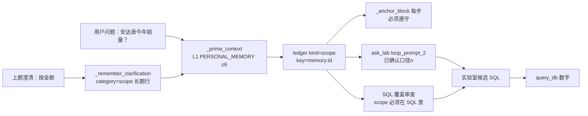
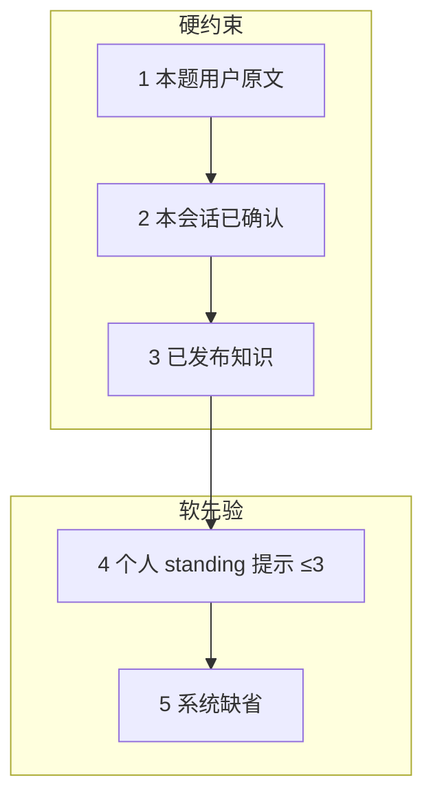
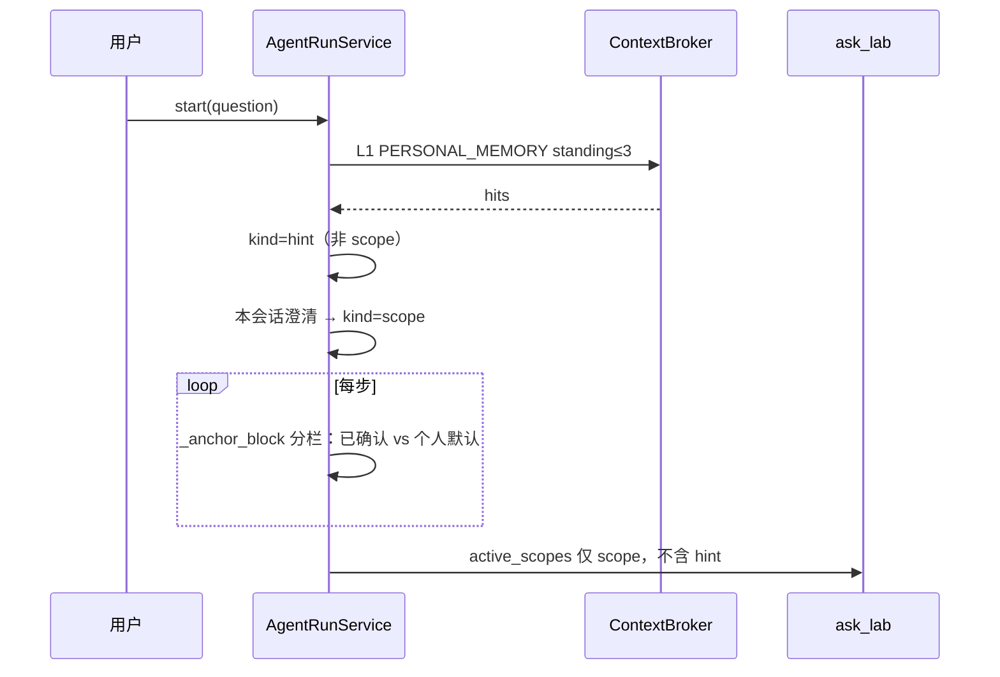
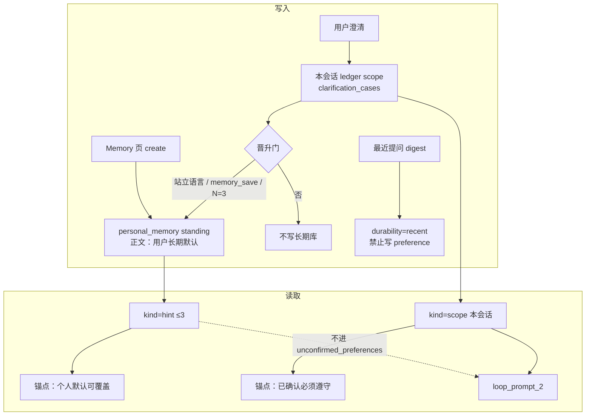

# 个人记忆权重下调：软先验、硬当前

| 字段 | 值 |
| --- | --- |
| 作者 | 工程设计 |
| 日期 | 2026-08-24 |
| 状态 | Draft |
| 产品 | 小英 / xiaoying_quick（`backend_v2`） |
| 范围 | 个人记忆的注入权重、写入路径、检索排序与提示词纪律 |
| 建议实现名 | `memory_mode=hint`（软先验）；回滚通道 `legacy` |
| 修订 | 第二轮：站立语言只扫本条 `free_text`；回填 ELSE=standing；个人专用召回不截 3 条；N=3 按答案对计次 |

---

## Overview

小英是制药市场数据的专业分析代理，不是消费级聊天机器人。用户问「安达唐今年销量？」时，过期或一次性的个人记忆会把 SQL 拧到错误指标（金额 vs 数量）、错误渠道或错误市场。当前个人记忆被多层机制叠成「必须遵守」的硬约束：启动时召回最多 6 条写入 `kind=scope`；每一步 `_anchor_block` 以「已确认口径（必须遵守）」重注；澄清答案无条件落入 `personal_memory_entries`；`knowledge_search` 与已发布知识混排；提示词写「立即生效」。另有一条**潜伏**路径：`_digest_recent_if_needed` 会把「问过：」摘要同时写成 `preference`，但当前 agent 循环并不写入「问过：」行。

本设计把个人记忆降为**软先验**：只作 prefills / 推荐 / 可覆盖提示。个人记忆（含 standing）**永远**只进台账 `kind=hint`，绝不进 `_active_scopes` / `loop_prompt_2` / SQL 审查白名单。本会话用户确认才是 `kind=scope`。优先级固定为：**本题用户原文 > 本会话已确认 > 已发布业务/实验室知识 > 个人长期默认（软） > 系统缺省**。v1 **不**做槽位级冲突检测，因此「本题点名销量则不得改金额字段」不是产品保证，而是 prompt 纪律；架构保证的是个人记忆绑不进实验室硬槽位。推荐方案是分层改造（下文 A–H），而不是引入 Mem0 / Zep，也不是把记忆改成纯工具召回。

---

## Background & Motivation

### 这是专业分析工具，权重必须可预测

消费级助手（ChatGPT 式每次预载用户画像）追求「懂你」；专业取数工具追求「这次问的就是这次算的」。Claude 早期专业形态把记忆做成工具、默认空白上下文；Letta / MemGPT 把常驻块压到 2–4KB 的蒸馏画像，而不是把原始澄清全文灌进窗口。本产品的用户投诉原意是：个人记忆这块现在权重太高了。一次「这题按金额」不该变成**新会话**里「安达唐今年销量」的默认金额口径；同会话追问「那盒数呢？」则仍应受上一轮确认约束。

业界 2025–2026 的生产共识是三层记忆，而不是单一向量库：

1. 当前任务的工作记忆（ephemeral，本题台账）
2. 会话级压缩记忆（本会话已确认口径）
3. 长期库按需召回（standing 默认，且排在已发布知识之后）

把三层用同一套 token-overlap 检索、再全部写成 `kind=scope`，是 Weaviate 所说的典型架构错误，也正是当前 `knowledge_search` 与 `_prime_context` 的做法。

### 现状：主因五层 + 一条潜伏升格

以下均已在代码中核实。生产错数的主因是 priming-as-scope + 澄清必写 + 锚点必须遵守 + 混排检索 + 提示词立即生效。digest 升 `preference` 是防御性删除对象，不是当前生产主因。

#### 1. 启动 priming 写成绑定台账（主因）

`AgentRunService._prime_context`（`backend_v2/src/xiaoying_quick/application/agent_run/loop.py`）在第一轮模型调用前：

- 用 ContextBroker 做 L1 召回，`allowed_source_types={PERSONAL_MEMORY}`，最多 `_PRIMED_MEMORY_LIMIT = 6`
- 把命中写成 `kind="scope"`，key 形如 `memory:{content_id}`
- 源码注释写明：这些条目会成为 binding scope，且锚点每一步重申

`_anchor_block` 每一步重写 system 消息，标题为：

> 已确认口径（必须遵守，与问题明显冲突时先 ask_user 确认）

且**只渲染** `caliber/term/constant/qualifier/formula`、`time`、`scope`。新 kind 若只入库、不加独立标题，模型在锚点里看不见。

`_trim_ledger` 在溢出时**从不丢弃** `kind=scope`，直到 scope 本身超过 `_LEDGER_MAX_ENTRIES = 20`。

更下游的绑定：

- `_active_scopes()` 只收集 `kind=scope`，经 `AgentToolContext.active_scopes` 进入 `build_ask_lab_tool`，填进实验室 `loop_prompt_2`（`已确认口径{n}=…`）
- `build_sql_review_user_prompt` 把 `scope` / `time` / `qualifier` / `constant` 当作 SQL 必须覆盖的约束（白名单不含未声明的 kind）
- `_inherit_ledger` 把上一轮的 `scope` / `time` 带进同一会话的下一问（`_DURABLE_LEDGER_KINDS`）；`_complete` 把 ledger 写入 completed transcript 供继承
- `_load_ledger` 不校验 kind，checkpoint 能保住未知 kind

`_question_caliber_slots` **只种时间窗口**（「今年」「H2」等）。产品 / 指标 / 渠道仍靠模型 `update_ledger` 写入。`kind=caliber` 不是已经存在的明文约束总线。

`pack_loop_prompts` 已有 `unconfirmed_preferences` 参数且注明「永不进入任何 slot」：它是 **forbidden 集合**，glossary 的 **key** 与 confirmed 的 **value** 命中即丢弃（`test_knowledge_pack.py` 用 `unconfirmed_preferences=("金额",)` 断言 `loop_prompt_2` 不含「金额」）。`build_ask_lab_tool` **从未传入**该参数——这是正确的，hint 正文经 `_memory_conclusion` 常是「金额」，原样传入会剥掉实验室已发布 glossary。

#### 2. 每次澄清都写入长期记忆（主因）

`resume` 在用户回答澄清后调用 `_remember_clarification`：无条件 `MemoryWriteRequest(category="scope")`，正文模板为：

```
原始问题：…
澄清问题：…
用户结论：…
（系统依据本轮澄清自动记录）
```

`_memory_conclusion` 的测试夹具还覆盖旧标记「（系统自动记录）」。事件 `memory.auto_saved` 让前端 ClarifyCard 显示「已存入个人记忆」（`frontend/src/chat.js`、`ClarifyCard.vue`）。`use_memory=false` 时跳过写入（评测路径已有）。提示词还告诉模型「用户对 ask_user 的回答会由系统自动总结并写入个人记忆，不必再调 `memory_save`」。

结果：本题一次性选择（金额而非盒数）成为下一**新会话** priming 的 standing 默认，并被 `_memory_conclusion` 抽成「金额」写进 `kind=scope`。

同会话路径本身是对的：`resume` 已 `_add_ledger(kind="scope", text="用户确认：…")`，`_session_clarified_scopes` 在下一轮 priming 这些结论，且**不看** `_use_memory`（`_prime_context` 里会话澄清循环在 `if self._use_memory` 之外）。

#### 3. 最近提问摘要升成 preference（潜伏路径 / 防御性删除）

`PersonalMemoryService._digest_recent_if_needed`（`modules/knowledge/service.py`）：原始「问过：」条目超过 `RECENT_QUESTION_LIMIT = 10` 后，`digest_recent_questions` 抽出最多 2 条洞察，**同时**写入 `category=recent` 与 `category=preference`。`looks_like_digest` 匹配 `近期(?:常问|提问偏好|多次追问)`。

全库除测试和 Memory 页模板外，**没有** agent 路径 `MemoryWriteRequest(category="recent", content="问过：…")`。因此这一层当前是哑火，除非用户手写或模型 `memory_save(category=recent)`。仍应拆掉升格环，以免以后被点亮；不要把它写成正在生产制造错数的主因。

#### 4. 与已发布知识同一候选池、同一套打分（主因）

`SqlAlchemyKnowledgeRecallSource.search`（`infrastructure/search/knowledge_recall.py`）把 `_personal()` + `_published()` + 会话补丁 + 运行时域卡片放进**一个**列表，按 `_score`（ASCII 词 + 汉字 bigram 重叠）排序。任意汉字 bigram 命中即 `≥ 0.5`。L1 `candidate_limit=32`。个人记忆无封顶时，可高于一篇 0.5 的已发布文档并占满候选。

| 机制 | 现状 | 后果 |
| --- | --- | --- |
| L0 `min_score` | `0.0`，且分数地板 `max(score, 0.72)` | 无关个人记忆也能常驻 |
| L0 允许源 | 含 `PERSONAL_MEMORY` | 与路由规则书抢预算（L0 为规则书存在，预算 9600 tokens） |
| L1 `min_score` | `0.45`；任意 bigram 命中分数 ≥ `0.5` | 「今年」「销量」即可召回大量无关记忆 |
| 会话补丁 | `score_override=0.99` | 正确，应保持 |
| 已发布 pinned 路由 | `1.0` + `resident_verbatim` | 正确，应保持 |
| 个人记忆 | 无封顶也无额外加分 | 混排会污染 `knowledge_search` 的 8 条结果 |
| `knowledge_search` | 单列表、无来源优先级 | 模型无法区分「已发布口径」与「个人习惯」 |

当前 agent 循环并未调用 L0（priming 与 `knowledge_search` 都走 L1）。L0 策略仍允许个人记忆，属于潜伏风险。L0 清理仍值得做，但不是当前错数主因。生产循环确实未调 L0（仅测试）。

`_personal()` 取出该用户 **全部** active 行。不要在这个共享函数上按 standing 一刀切：`knowledge_search` 的「个人习惯（参考）」分组仍需要 episodic / recent。

#### 5. 提示词把记忆写成立即绑定（主因）

`AGENT_SYSTEM_PROMPT`（版本 `agent-v13`）「知识沉淀」节：

- 个人写入：「直接写入个人记忆，**立即生效**」
- 「用户对 ask_user 澄清的回答会由系统自动总结并写入个人记忆」

`memory_save` 工具 description 原文（不要改写成未出现过的句子）：

> 检索知识库：按语义召回业务知识、实验室文档与个人记忆。

（上句是 `knowledge_search` 的 description。）`memory_save` 的 description 原文是：

> 知识沉淀：把用户声明的默认口径、偏好、指标定义或纠偏持久化为可复用知识。scope=personal 直接写入提问者个人记忆（立即生效）；scope=review 提交知识审核队列（共享口径/指标定义，人工审核后生效），并用 target 指定去向（business 或对应实验室）。只沉淀有复用价值的口径，不要沉淀一次性数字。

成功文案：

> 已写入个人记忆（…，立即生效，id=…），后续问答将自动召回该口径。

#### 6. 与已发布知识不对称

`knowledge_entries` / `knowledge_candidates` 有 `valid_from` / `valid_until` / `applicability`（迁移 `20260806_0003_knowledge_provenance_validity.py`）。`personal_memory_entries` 只有 `category` / `content` / `state`，没有 TTL、置信度、standing vs episodic 标志。过期偏好无法失效，只能靠用户去 Memory 页手删。v1 **不**把已发布知识的 `applicability` 搬到个人表——个人侧没有消费者。

### 已经做对、必须保留的部分

| 能力 | 位置 | 为何保留 |
| --- | --- | --- |
| 属主 ACL | `RecallPolicy.authorize`：`PERSONAL_MEMORY` 要求 `hit.owner_id == request.actor_id` | 安全底线 |
| Memory 页 + 修订 + 撤销 | `frontend/src/views/MemoryView.vue`，`/api/v2/memory`，`personal_memory_revisions` | 用户可见、可纠错 |
| 按 run 关闭记忆 | `ChatRequest.use_memory`、`_resolve_use_memory`、评测页 `eval.html` 固定 `use_memory: false` | 评测与干净对照 |
| 澄清卡预填 | `recommended` + `source=personal_memory` + 「按你的习惯」（`ClarifyCard.vue`）；`ClarificationChoice.source` 与 `_card_groups` 已透传；`frontend/tests/store.test.js` 已覆盖 `source: 'personal_memory'` | **这是正确权重**：预填而非绑定。缺口在 `_open_case` 未根据 hint 打标；**不要**幻想从模型 `ask_user` 选项读 `option.source`（`_ask_user_groups` 把 options 规范成纯字符串再变成 `{label, recommended}`） |
| 显式长期意图 | `memory_save` 工具 | 用户说「请记住 / 帮我记住」时的正道 |
| 同会话继承 | `_inherit_ledger` 继承 `scope` / `time`；`_session_clarified_scopes` 每轮 priming | 追问「那盒数呢？」需要本题已确认口径，不是长期记忆。该路径在 `off/hint/legacy` 下都跑 |

### 错误传播路径（为何会算出错数）



一次过期或一次性的「金额」记忆，会同时改写模型注意力、实验室生成与 SQL 审查，三者同向，几乎没有纠偏机会。

---

## Goals & Non-Goals

### Goals

1. 个人记忆（含 standing）**永远**不得写成 `kind=scope`。standing 只作为 `kind=hint` 软先验；本会话用户确认才是 `kind=scope`。v1 用架构切断实验室硬槽位（`_active_scopes` / `loop_prompt_2` / SQL 审查白名单不含 hint），不承诺槽位级「本题点名销量则不得改金额字段」。
2. 澄清结论默认只活在本会话台账 / `clarification_cases`；晋升长期记忆需要本条 `free_text` 上的显式语言、`memory_save`，或按答案对跨问题重复 N=3（通用度量结论除外）。
3. 检索与提示词显式分层：已发布口径高于个人习惯；输出分组标注。个人与已发布**分开召回再拼接**。
4. 数据模型用最小增量区分 `standing` / `episodic` / `recent`；已有自动澄清行回填为 `episodic`；digest 文案回填为 `recent` 并撤销错误升上来的 `preference` 副本。
5. 用 `memory_mode=off|hint|legacy` 灰度与回滚。代码默认 `hint`；生产第一周用环境变量 `XIAOYING_MEMORY_MODE=legacy`，行为不随 PR1 合入立刻切换。`use_memory=false` 语义不变，且覆盖一切。
6. 可观测：priming 写成 scope 的次数降到 0；澄清自动长期写入降到 0；晋升单独计数。

### Non-Goals

- 不引入 Mem0、Zep / Graphiti、LangMem 或任何新记忆框架依赖。
- 不建知识图谱，不做 bitemporal 事实层。
- v1 不做 sleep-time LLM 异步整合；N=3 启发式足够。
- 不改已发布知识的审核流（`scope=review` / Review 页）。
- 不删除 Memory 页，不删除 `use_memory=false`。
- v1 不新增 `confidence` 字段（过重）。
- v1 不新增 `applicability` 列（没有消费者；过滤是 v2）。
- 不把个人记忆做成完全的工具召回（见备选 1）；长期默认渠道仍应有一条弱提示，避免每次都问渠道。
- 不在 v1 做跨用户记忆、共享个人画像。
- v1 **不做槽位级冲突检测**（本题点名的指标/产品 vs hint 结论）。`ask_lab.question` / `remark` 仍是残留通道，靠工具 description 纪律；结构化拦截是 v2。
- v1 **不做**聊天顶栏「已参考你的默认」芯片（没有现成组件）。可观测性走事件 + AgentTrace。
- v1 Memory 页只支持撤销，**编辑不得改变 `durability`**；不提供 standing ↔ episodic 降级 UI。

---

## Key Decisions

1. **产品哲学取 Claude-professional + Letta-core-tiny，不取 ChatGPT-always-on。** 专业取数要可预测。常驻块只允许极小的 standing 默认（最多 3 条），且标题写明可被本题覆盖。
2. **优先级栈写进提示词、检索排序、台账 kind 三处，缺一不可。** 只改 prompt 挡不住 `loop_prompt_2` 和 SQL 审查；只改 priming 挡不住 `knowledge_search` 混排。本题明文的硬约束载体是**用户消息**与本会话 `scope`；`kind=caliber` 目前只种时间窗口，不要当成完整约束总线。
3. **个人记忆改用新 kind `hint`，绝不进 `_active_scopes`。** 实验室 `loop_prompt_2` 与 SQL 审查继续只看本会话确认的 `scope` / `time` / `qualifier`。**不要**把 hint 传入 `unconfirmed_preferences`（那是 forbidden 集合，会剥掉已发布 glossary）。实验室侧只保证 `active_scopes` 不含 hint。
4. **澄清默认不写 `personal_memory_entries`。** 本会话台账已经通过 `_add_ledger(kind=scope)` 与 `_session_clarified_scopes` 生效。长期化走三条晋升门。站立语言**只扫本条澄清的 `free_text`**，不扫原始问题（题干里的「以后都…」走 `memory_save` 提示词纪律）。N=3 **按答案对**计次，抄 `list_waiting` 的 **AND** 连接：`RunModel.owner_user_id == owner` **且** `ChatSessionModel.owner_id == owner`。通用度量排除按单条结论（金额 / 盒数 / 数量）。
5. **`category` 保留，新增 `durability`。** `category` 是 Memory 页的文档结构（偏好 / 口径 / 指标 / 术语 / 最近）；`durability` 才是注入资格。二者正交，避免把「指标定义」误当成「必须常驻」。
6. **先解析唯一的 `MemoryMode`，再派生 `_use_memory = (mode != "off")`。** 不把 `use_memory` 与 `memory_mode` 当成两套运行时状态。请求体 `memory_mode` 是 `Optional`，缺省 `None` 表示未声明。Resume **不加** `memory_mode` 字段，只读 checkpoint。`use_memory=false` 强制 `off`，优先级最高。
7. **检索拆层而不是换模型。** 继续用现有 token-overlap；个人与已发布分开召回再拼接。混排（还会召回已发布知识）时已发布先填预算、个人最多 3 条且 `min(score, 0.65)`。`allowed_source_types` 只有 `PERSONAL_MEMORY` 的 priming 路径返回该用户个人命中（上限 L1 `candidate_limit`），由 `_recall_memory_scopes` 再做 standing + `score≥0.55` + 最多 3。不要在共享 `_personal()` 上按 standing 过滤。v1 不上向量库。
8. **指标定义冲突：已发布知识胜出。** 个人 `metric_definition` 不得默默覆盖实验室文档。本题歧义时用澄清卡预填（正确权重），而不是绑定。
9. **继承时丢掉历史 `memory:*` key。** 灰度后，旧会话台账里 priming 留下的 scope 会经 `_inherit_ledger` 继续绑下一问。`hint` / `off` 模式下继承阶段丢弃这些 key。hint 本身不在 `_DURABLE_LEDGER_KINDS` 中。
10. **不在热路径跑 LLM 整合。** 晋升用规则（站立语言 / 显式工具 / N=3），与 Letta sleep-time agent 的方向一致，但 v1 保持零新模型调用。
11. **Standing hint 块条数 = 3。** （原 OQ1）0 最干净但默认渠道便利下降；6 几乎等于现状注意力占用。3 与 Letta 常驻块「小而蒸馏」一致。
12. **澄清自动晋升采用 N=3。** （原 OQ2）永不最安全但懒用户没有长期默认；每次都写即本次要关掉的行为。N=3 按本题**每一条**归一化结论各算一次（含本题为第 1 次，第三次晋升）；历史 case 展开为答案对，任一对命中则该 `run_id` 对该结论计 1。
13. **个人 `metric_definition` 与实验室文档冲突：已发布始终胜出。** （原 OQ3）每次都问会打断取数；个人胜出会让同一题在不同用户间口径分裂。歧义槽位才 `ask_user`。
14. **N=3 时间窗默认 90 天。** （原 OQ4）不把窗口留到实现现场发挥。
15. **Memory 页 v1 只支持撤销；markdown 编辑不得改变 `durability`。** （原 OQ5）`reconcile` 命中已有行时保留其 `durability`；API update 的 durability 为 `None` = 不改；create 才默认 `standing`。
16. **代码 `Settings.memory_mode` 默认 `hint`，生产第一周用 `XIAOYING_MEMORY_MODE=legacy`。** PR1 合入不等于生产立刻切 hint。普通聊天顶栏不暴露该开关；评测页加内部-only 对照。

---

## Proposed Design

名称：**软先验、硬当前**。

### 优先级栈（必须同时出现在 prompt、排序、台账）

| 秩 | 来源 | 绑定力 | 载体 |
| --- | --- | --- | --- |
| 1 | 本题用户原文（产品 / 时间 / 指标 / 渠道） | 硬（prompt 纪律；v1 无槽位拦截） | 用户消息。`kind=caliber` **仅**时间窗口种子 |
| 2 | 本会话已确认澄清 | 硬（仅本会话） | `kind=scope`，可继承 |
| 3 | 已发布业务 / 实验室知识 | 硬（治理过的口径） | `knowledge_search` 已发布分组、L2 文档 |
| 4 | 个人记忆 standing 默认 | 软：预填 / 提示 / 推荐 | `kind=hint` 或澄清卡 `source=personal_memory` |
| 5 | 系统缺省 | 软 | 实验室文档与模型常识 |

个人记忆**永远**不得升到秩 1–2。本会话确认可以把一条口径变成秩 2（`kind=scope`）；长期 standing 仍只是秩 4 的 `hint`。



### 模式：`memory_mode`（单一运行时状态）

| 值 | 含义 | 谁用 |
| --- | --- | --- |
| `off` | 不 priming 个人记忆、不召回个人、不写入。等价于今天的 `use_memory=false` | 评测、干净对照 |
| `hint` | 新默认（代码与 Settings）。standing 最多 3 条进 `kind=hint`；澄清不自动长期化 | 生产（env 切过来之后） |
| `legacy` | 完全保持今天的 priming-as-scope 与澄清自动写入 | 回滚；生产第一周 env |

先解析出唯一的 `MemoryMode`，再派生：

```python
self._memory_mode = _resolve_memory_mode(...)
self._use_memory = self._memory_mode != "off"
```

`extras["use_memory"]` 继续等于 `self._use_memory`，这样 `tools._memory_enabled` 不用改语义：`off` 关个人源，`hint`/`legacy` 开个人源。`knowledge_search` / `memory_save` 看的是这一个派生旗，不会出现 `Settings.memory_mode=off` 而 `_use_memory` 仍为 True 的分裂。

#### 解析顺序

实现放在 `loop.py` 的 `_resolve_use_memory` 旁，新增 `_resolve_memory_mode`。`_resolve_use_memory` 可保留给测试过渡，生产路径只走 mode。

1. `use_memory is False` → `off`（覆盖一切，含请求体 `memory_mode` 与 checkpoint）
2. 请求体显式 `memory_mode in {off, hint, legacy}`（仅 **start**；resume 签名不加此参数）
3. checkpoint 中的 `memory_mode`（resume / 崩溃续跑）
4. 旧 checkpoint 无 `memory_mode` 但 `use_memory is False` → `off`
5. `memory_mode_default`（来自 `Settings.memory_mode` / `XIAOYING_MEMORY_MODE`，代码默认 `hint`）

请求体 `memory_mode: Literal["off","hint","legacy"] | None = None`，`None` = 未声明，**不要**缺省成 `hint`（否则 env=`legacy` 的分钟级回滚会被聊天 UI 的「没传字段」打成 hint）。`ChatRequest.use_memory` 保持默认 `True`；路由继续 `use_memory=None if body.use_memory else False`（显式 true 与缺省无法区分，沿用现状）。Job payload **只在显式有值时写入** `memory_mode`。

**Resume 路径：** `ClarificationSubmitRequest` **不要**加 `memory_mode` 字段。`enqueue_quick_resume` / `_model_options_payload` 的 resume 分支不写该键。`AgentRunService.resume` 签名不加 `memory_mode`；只读 checkpoint。前端 `currentModelOptions()` 今天不传该字段——必须保住。

`_model_options()`（`bootstrap/jobs.py`）今天只解析 `use_memory` 的 `"false"`/`"true"`，PR1 必须同时认识 `memory_mode`。`AgentRunService.start` 增加 `memory_mode: str | None = None` 与 `memory_mode_default: str = "hint"`；`resume` 只加 `memory_mode_default`。jobs 执行层传入 `memory_mode_default=get_settings().memory_mode`。

Checkpoint（`_save_checkpoint`）写入解析后的 `"memory_mode"` 与派生的 `"use_memory"`。`_complete` 今天只写 `turn_messages/status/ledger`；继承不依赖 completed transcript 里的 mode，新 start 自行解析。旧 checkpoint 无 `memory_mode` 时回落到 Settings；灰度从 `legacy` 切 `hint` 前应排空 `waiting_clarification`，或接受这批 resume 跟新默认。

#### 真值表

`(use_memory, request.memory_mode, checkpoint.memory_mode, Settings) → mode`。`use_memory` 列是 **job/start 解析后的显式值**（路由把默认 True 收成 `None`）。

| # | use_memory | request.memory_mode | checkpoint | Settings | → mode | 说明 |
| --- | --- | --- | --- | --- | --- | --- |
| 1 | `False` | `hint` / `legacy` / `None` | 任意 | 任意 | `off` | `use_memory=false` 覆盖一切 |
| 2 | `True` 或 `None` | `off` | 任意 | `hint` | `off` | 显式 mode=off，即使 use_memory 为 true |
| 3 | `None` | `None` | 无（新 start） | `hint` | `hint` | 代码默认 |
| 4 | `None` | `None` | 无（新 start） | `legacy` | `legacy` | 生产第一周 env |
| 5 | `None` | `hint` | 无 | `legacy` | `hint` | 内部评测页显式对照 |
| 6 | `None` | `None` | `{memory_mode: legacy}` | `hint` | `legacy` | resume 省略字段，读 checkpoint |
| 7 | `False` | （resume 无此字段） | `{memory_mode: hint}` | `hint` | `off` | resume 仍可被 use_memory=false 关掉 |
| 8 | `None` | `None` | `{use_memory: False}`（无 memory_mode） | `hint` | `off` | 旧 checkpoint |
| 9 | `None` | `None` | `{use_memory: True}`（无 memory_mode） | `legacy` | `legacy` | 旧 checkpoint 回落 Settings |
| 10 | `False` | — | — | — | `off` | `eval.html` 只送 `use_memory: false` |

`_session_clarified_scopes` 在 `off/hint/legacy` 下都继续 priming，与个人记忆开关无关。评测必须每题新 session，否则上一题确认会经会话路径进入本题——这是有意的会话语义。

### A. 停止把个人记忆写成绑定 scope

**改** `AgentRunService._prime_context`：

- `legacy`：保持现行为，便于回滚。
- `off`：跳过 `_recall_memory_scopes`（`if self._use_memory` 在派生后自然成立）。
- `hint`：召回结果**禁止** `_add_ledger(..., kind="scope")`。改为 `_add_ledger(..., kind="hint", key="hint:{content_id}")`。写入台账以便 AgentTrace 与事件流看见，且自然进入 checkpoint。

`kind=hint` **仅由** `_prime_context` 系统写入。`update_ledger(kind=hint)` 必须拒绝。

拆常量（`tools.py` 今天 `LEDGER_ENTRY_KINDS` 同时做 UI 标签、`kind not in` 与 JSON enum——往该 dict 加 `hint` 等于允许模型把猜测标成个人默认）：

```python
MODEL_LEDGER_KINDS = {
    "term": "术语映射",
    "constant": "常量",
    "qualifier": "限定条件",
    "formula": "指标公式",
    "scope": "口径结论",
    "time": "时间事实",
}
LEDGER_KIND_LABELS = {
    **MODEL_LEDGER_KINDS,
    "hint": "个人默认",
}
# update_ledger: kind not in MODEL_LEDGER_KINDS → 拒绝
# JSON enum = list(MODEL_LEDGER_KINDS)
# 前端展示用 LEDGER_KIND_LABELS
```

`kind=hint` 纪律（必须写进常量，避免回归）：

| 消费者 | 对 `hint` 的态度 |
| --- | --- |
| `_DURABLE_LEDGER_KINDS` | **不包含**（不跨问继承提示） |
| `_CONSTRAINT_LEDGER_KINDS` | **不包含**（改 hint 不得作废 query_db 事实） |
| `_active_scopes()` | **过滤掉**（`kind == "scope"` 已满足；加单测锁住） |
| `_trim_ledger` | 可丢弃（与 caliber 同等，不享受 scope 豁免） |
| `build_sql_review_user_prompt` | **忽略**（白名单无 hint 即忽略） |
| `build_ask_lab_tool` | 不进 `confirmed`；**不**传 `unconfirmed_preferences` |
| `_anchor_block` | **必须**独立标题，否则模型看不见软先验 |
| `_inherit_ledger` | 不继承 hint；并在 `hint`/`off` 下丢弃 key 前缀 `memory:` 的旧条目 |
| `_load_ledger` | 不校验 kind（checkpoint 能保住 hint） |
| `_complete` | 把含 hint 的 ledger 写入 transcript；继承侧丢弃即可 |
| `update_ledger` | **拒绝** `kind=hint` |
| `AgentTrace.vue` `durableLedger` | **不包含**（仍只 `scope\|time`） |

锚点文案（`_anchor_block` 在 scopes 段之后追加 hints 段；「必须遵守」标题下不得出现 `memory:` / `kind=hint`）：

```
已确认口径（必须遵守，与问题明显冲突时先 ask_user 确认）：
- 用户确认：… → …

个人默认（可被本题覆盖，不得改写问题里已经点名的产品/时间/指标/渠道）：
- …
```

后一句是 **prompt 纪律**，不是 v1 验收保证。

条数：`_PRIMED_HINT_LIMIT = 3`。仅 `durability=standing`，且召回分 ≥ `0.55`，仍跳过「问过」「提问「」前缀。本会话 `_session_clarified_scopes` **继续**写成 `kind=scope`。

`durability` 列就绪前（PR1 早于 PR3），用只读启发式：正文含「系统依据本轮澄清自动记录」或「系统自动记录」，或 `looks_like_digest` → 不当作 standing；**其余无标记行当作 standing**（与 PR3 回填 ELSE=standing 对齐）。**不要**用这段启发式把带自动记录标记的行升成 standing——黄金题 2 要等到 PR2：用户在澄清 **free_text** 提交「以后都只查重点民营机构」，或模型 `memory_save`。

同会话继承消毒：

```python
_LEGACY_MEMORY_KEY_PREFIX = "memory:"

# _inherit_ledger 在 memory_mode != legacy 时：
if str(entry.get("key") or "").startswith(_LEGACY_MEMORY_KEY_PREFIX):
    continue
```



`ask_lab` 残留通道：`question` 与 `remark` 仍由模型自由填写。今天 remark description 是「可选：本次问题的补充备注，如已确认的口径、上一步结论代入的上下文」。v1 在 `build_ask_lab_tool` 的 remark / question description 里禁止把「个人默认」或 hint 正文写入 remark；加单测锁定 description 字符串。模型仍可能改写问句——标为残留风险，结构化拦截是 v2。

PR1 验收补一条：hint 结论为「金额」时，`loop_prompt_1` 仍可含已发布「金额」词条（即 **未** 把 hint 塞进 `unconfirmed_preferences`）。

### B. 澄清写入：会话优先，事后晋升

**改** `_remember_clarification`：`hint` / `off` 下默认**不**调用 `memory_writer.write`。

本会话路径保持不变（已存在，不要重复造存储）：

- `resume` 里已 `_add_ledger(kind="scope", text="用户确认：…")`
- `_session_clarified_scopes` 已能在同会话下一轮 priming 这些结论，且在所有 `memory_mode` 下运行
- `clarification_cases` 已持久化问答

晋升到 `personal_memory_entries` 仅当下列之一：

| 门 | 规则 | `durability` |
| --- | --- | --- |
| 1. 站立语言 | 见下：只扫**本条**澄清的 `free_text` | `standing` |
| 2. 显式工具 | 模型调用 `memory_save` | `standing`（默认） |
| 3. 重复 N=3 | 同一属主、**不同** `run_id`、同一归一化结论出现 ≥ 3 次（含本题该条；按答案对） | `standing` |

`_remember_clarification` 按 `answered` 的每一对 `(prompt, reply)` 分别判定三门，互不影响。同一 case 里「金额」点选与「以后都只查重点民营机构」free_text 可以只晋升后者。

#### 门 1：站立语言（只扫本条 `free_text`）

**只扫描本条澄清的 `free_text`：** `ClarificationAnswer.free_text`（submit 里 `item.free_text` 且未被 `_answer_case` 匹配成 `choice_id`）。对 `answered` 的每一对独立判断：该 reply 对应的 answer 必须真是 free_text，且 `_has_standing_language(free_text)` 为真，才晋升**这一条**结论。

**禁止扫描：**

- 本题用户消息 / `_run_question_from_checkpoint`（题干「以后都只查重点民营机构」走 `memory_save` 提示词纪律，不经本门把同轮点选的「金额」写成 standing）
- 模型写的澄清 `prompt` / `question.prompt`
- 选项 `label`（含「金额（以后都用这个）」这种修饰）
- 由 `choice_id` 反查得到的 label 拼进 `answer` 的字符串（`_answer_projection` 在无 free_text 时用 label 填 `text`）

`_answer_case` 今天：reply 与某 `choice.label` 全等则记 `choice_id`、`free_text=None`。因此用户点选、或 typed-equal-to-label，本门都不触发。

触发短语（去掉短触发词 `默认` / `记住` / `长期`，避免「默认市场」「长期处方」「我记住了」）：

```python
_STANDING_PHRASES = ("以后都", "以后就", "每次都", "不要再问", "固定用")
_STANDING_REMEMBER = re.compile(
    r"(?:^|[\s，。；、！？\n])(?:请记住|帮我记住)"
)

def _has_standing_language(text: str) -> bool:
    t = unicodedata.normalize("NFKC", text or "").strip()
    if any(p in t for p in _STANDING_PHRASES):
        return True
    return bool(_STANDING_REMEMBER.search("\n" + t))
```

匹配**不用**包含关系。「金额」不得打中「金额达成率」。晋升正文用该条 free_text 作 `{label}`（可截断），不是题干、也不是同案其他问的选项。

反例单测（PR2 必做）：

- 用户问题含 `以后都只查重点民营机构`，同轮点选「金额」→ **不得**晋升「金额」（触发短语与 `{label}` 不是同一槽位）
- 用户问题 `安达唐默认市场销量` + 点选「金额」→ 不得晋升
- 选项 label 为「金额（以后都用这个）」且用户只点选 → 不得晋升

正例：该条澄清 **free_text** 提交「以后都只查重点民营机构」或「以后都用金额」→ 晋升这一条。题干里的「以后都…」本身不走本门，靠模型 `memory_save`。

#### 门 3：N=3 计次

`ClarificationCaseModel` 没有 `owner_id`，payload 是 JSON。**不要**为 v1 改表。新增 `ClarificationCaseRepository.list_answered_for_owner`，ACL 抄 `list_waiting` 的 **AND**（不是 OR）：

```python
select(ClarificationCaseModel)
.join(RunModel, RunModel.id == ClarificationCaseModel.run_id)
.join(ChatSessionModel, ChatSessionModel.id == ClarificationCaseModel.session_id)
.where(
    ClarificationCaseModel.status == ClarificationStatus.ANSWERED.value,
    RunModel.owner_user_id == owner_id,
    ChatSessionModel.owner_id == owner_id,
    ClarificationCaseModel.created_at >= now - timedelta(days=90),
)
```

不要用 `limit=50` 当时间窗的替代（活跃用户会丢掉更早的重复，N=3 失效）。默认 lookback **90 天**；安全上限例如 500 条以约束 resume 延迟（Observability 目标 < 50ms）。

伪代码（**按答案对**，不是按 case。本题该条算第 1 次，第三次晋升）。调用点：`_remember_clarification` 对 `answered` **每一对** `(prompt, reply)` 各调一次 `should_promote_n3`。

```python
_GENERIC_METRIC_LABELS = frozenset({"金额", "盒数", "数量"})

def _norm(text: str) -> str:
    return "".join(unicodedata.normalize("NFKC", text or "").split()).casefold()

def _pair_conclusions(case) -> list[str]:
    """展开一个 case 的每一对答案：choice.label 或 free_text。"""
    by_qid = {a.question_id: a for a in case.answers}
    out = []
    for question in case.questions:
        entry = by_qid.get(question.question_id)
        if entry is None:
            continue
        if entry.choice_id:
            choice = next((c for c in question.choices if c.choice_id == entry.choice_id), None)
            if choice and choice.label.strip():
                out.append(choice.label)
                continue
        text = (entry.free_text or "").strip()
        if text:
            out.append(text)
    return out

def should_promote_n3(owner_id, current_run_id, current_label: str) -> bool:
    target = _norm(current_label)
    if target in {_norm(x) for x in _GENERIC_METRIC_LABELS}:
        return False  # 只走站立语言 / memory_save；排除按单条结论
    count = 1  # 本题这一条
    seen = {current_run_id}
    for case in repo.list_answered_for_owner(owner_id, since=now - 90d):
        if case.run_id in seen:
            continue
        # 任一对与本题该条 _norm 相等 → 该 run_id 对本结论计 1
        if any(_norm(item) == target for item in _pair_conclusions(case)):
            seen.add(case.run_id)
            count += 1
            if count >= 3:
                return True
    return False
```

要点：

- 含本题该条；不同 `run_id`；`status=answered`。多问 case 不得拼成一个「整案结论」去比较
- 同一 case「金额」+「只查重点民营机构」：只让后者走 N=3（金额被通用度量排除）
- 同一会话连答三次「金额」：**不**晋升。非通用结论（如「只查重点民营机构」）跨 3 个 run 可以晋升，即使同会话——可接受
- `free_text` 与选项 label 走同一 `_norm`，v1 不做「金额≈销售额」语义合并
- **插入前去重**：`owner_id` + 归一化结论已有 active standing → 只发 `memory.promoted_from_clarify`（带已有 `entry_id`），不 `create` 第二行

#### 晋升正文模板（PR2 / PR3 对齐）

**禁止**复用 `_remember_clarification` 的「系统依据本轮澄清自动记录」模板，否则 PR3 回填会把刚晋升的行标成 `episodic`。

```
用户长期默认：{label}
```

可附一行适用范围（原始问题截断），但不得含「系统依据本轮澄清自动记录」或「系统自动记录」。PR3 回填：此前缀 → `standing`。不把 durability 列提前到 PR2：晋升路径在 PR3 之前没有该列，靠模板前缀对齐回填即可。

`legacy` 模式保留 `_remember_clarification` 现行为，使回滚不依赖数据迁移。

前端文案：

- 未晋升：ClarifyCard 显示「本轮已确认」，**不要**再因 `memory.auto_saved` 显示「已存入个人记忆」
- 已晋升：继续「已存入个人记忆」，事件改为 `memory.promoted_from_clarify`

`frontend/src/chat.js` 对未知事件是静默 fall-through，但 `memory.session_confirmed` / `memory.promoted_from_clarify` **必须在 PR2 改 switch**，否则「本轮已确认」没有数据源：

- `memory.auto_saved` 与 `memory.promoted_from_clarify` → `memorySaved=true`
- `memory.session_confirmed` → `sessionConfirmed=true`（ClarifyCard 显示「本轮已确认」）

### C. Standing vs episodic（最小 schema）

`category` 不动：`preference` / `scope` / `metric_definition` / `terminology` / `recent`。

v1 只新增：

| 列 | 类型 | 含义 |
| --- | --- | --- |
| `durability` | `VARCHAR(16)` NOT NULL | `standing` \| `episodic` \| `recent` |

**不加** `applicability`。已发布知识的 `applicability` 是另一套治理字段；个人表 v1 没有过滤消费者，加列会拖大 API / Memory 页 / 回填。过滤是 v2。

`confidence` 列为 non-goal。

写入规则：

| 来源 | `durability` |
| --- | --- |
| Memory 页 **create**（`POST /api/v2/memory`） | 默认 `standing` |
| Memory 页 **update**（markdown 往返） | **不改** `durability`（`None`） |
| `memory_save` | 默认 `standing` |
| 澄清晋升（站立语言 / N=3） | `standing`，模板 `用户长期默认：{label}` |
| 澄清自动记录（仅 `legacy` 或误入） | `episodic`，**永不** `standing` |
| `_digest_recent_if_needed` 产出 | `recent`；**禁止**再写一条 `preference` |
| 原始「问过：」行 | `recent` |

常驻 hint 块**只**接受 `standing`。`episodic` / `recent` 仅在 `knowledge_search` 的「个人习惯（参考）」分组出现，且受分数封顶与条数上限。

**必须删除的升格环**（防御性，即使当前 agent 不写「问过：」）：`PersonalMemoryService._digest_recent_if_needed` 中这段：

```python
if content not in existing_pref:
    self._repository.create(..., self._guarded_write("preference", content, source_run_id))
```

删除后，digest 只更新 `category=recent`。`test_eleventh_recent_question_collapses_into_two_insights` 里 `assert prefs` 改为断言无新 preference。

与已发布口径冲突的个人 `metric_definition`：v1 不自动改 `scope=review`。注入层让已发布胜出；提示词禁止用个人定义覆盖实验室字段映射。若用户明确要求沉淀为共享口径，仍走现有 `memory_save(scope=review)`。

回填见「Data Model Changes」。

### D. 检索拆层

原则：记忆层、知识层、工作记忆检索语义不同。停止把个人记忆与已发布知识当平等候选。

**`search()` 改为分路召回再拼接**（不要只封顶混池）。今天 `search()` **不读** `allowed_source_types`，由 `ContextBroker.authorize` 事后过滤；改造后必须读该字段，否则 priming 会被「个人最多 3」截断。

```python
_PERSONAL = RecallSourceType.PERSONAL_MEMORY

def search(self, request, *, candidate_limit: int):
    allowed = request.allowed_source_types
    want_personal = allowed is None or _PERSONAL in allowed
    personal = self._personal(request) if want_personal else []
    # 不在 _personal() 上按 standing 过滤
    for hit in personal:
        hit.score = min(hit.score, 0.65)

    personal_only = allowed == frozenset({_PERSONAL})
    if personal_only:
        # priming：_recall_memory_scopes 的 L1 + {PERSONAL_MEMORY}
        # 返回该用户个人命中，上限 candidate_limit（L1 为 32），
        # 不要在这里截 3。standing / score≥0.55 / 最多 3 由调用方过滤。
        return tuple(sorted(personal, key=...)[:candidate_limit])

    published = [
        *self._published(request),
        *self._session_patches(request),
        *self._runtime_domain_cards(request),
    ]
    published_ranked = sorted(published, key=...)[:candidate_limit]
    personal_ranked = sorted(personal, key=...)[:3]  # 仅混排限制个人 3 条
    # 已发布先填预算；个人再补，且最终列表里已发布条数 >= 个人条数（有已发布命中时）
    ...
```

- 个人记忆（混排）：`score = min(raw, 0.65)`。已发布 pinned 路由保持 `1.0`，会话补丁保持 `0.99`。
- 个人记忆**不要**吃 L0 地板 `0.72`。
- **不要**在共享 `_personal()` 上按 standing 一刀切。`knowledge_search` 的个人分组仍可含 episodic / recent。
- **不要**无条件 `personal[:3]`。`personal_budget = min(3, candidate_limit - 0)` 恒为 3，会让 priming 先拿到分数最高的任意 3 条，再丢非 standing 后可能剩 0，第 4 条 standing 永不注入。

**L0：** 从 `RecallPolicy.quick_default()` 的 `L0_RESIDENT.allowed_source_types` **移除** `PERSONAL_MEMORY`。验收写成「`allowed_source_types` 不含 `PERSONAL_MEMORY`」，不要写成「`authorize` 拒绝」——交集为空时 DENIED_SOURCE 成立，但测试应直接锁 policy。standing 提示由 priming 专用通道注入，不走 L0。

**L1 priming（hint 模式）：** `_recall_memory_scopes` 继续 `allowed_source_types={PERSONAL_MEMORY}`。`search()` 走个人专用分支，返回最多 `candidate_limit` 条个人命中。然后本函数过滤：仅 `standing` + `score ≥ 0.55` + 最多 `_PRIMED_HINT_LIMIT = 3`。不必给 `RecallRequest` 加 `durability_filter`。PR4 单测：若干高分 episodic 不得挤掉第 4 条 standing 的 priming（search 返回含该 standing，过滤后 hint 块含它）。

**`knowledge_search` 输出**（`build_knowledge_search_tool`，仍最多 8 条，但分组）。改写 description 时引用真实现句，去掉「立即生效」类暗示，**不要**声称现状写过「与个人记忆一视同仁」（那句不存在）：

```
检索到 N 条相关知识（已发布口径优先于个人习惯）：

## 已发布口径
【business_knowledge · {id} · score=…】
…

## 个人习惯（参考，不得覆盖本题已点名约束或已发布口径）
【personal_memory · {id} · standing|episodic · score=…】
…
```

排序：先已发布（及会话补丁），后个人。

**冲突：**

- 个人记忆 vs 已发布实验室 / 业务知识 → 已发布胜出；个人仅出现在参考分组。
- 两者都合理且本题槽位歧义（金额 vs 数量、渠道）→ `ask_user`，澄清卡预填个人习惯（`recommended` + `source=personal_memory` + 「按你的习惯」）。这是正确权重，保持。
- 实现：`_open_case` 对 `kind=hint` 的结论与选项 label 做 **NFKC 后完全相等** 时打上 `source=personal_memory`。比较前剥掉晋升前缀 `用户长期默认：` 并走 `_memory_conclusion`，避免模板正文与短 label 对不上。「金额」不得包含匹配「金额达成率」。**不要**读取 `option.get("source")`——模型 options 在 `_ask_user_groups` 里已被规范成纯字符串。PR2/PR5 验收用现有 `frontend/tests/store.test.js` 的 `source: 'personal_memory'` 卡即可。

### E. 提示词改写

`AGENT_PROMPT_VERSION`：`agent-v13` → `agent-v14`。

「知识检索顺序」后插入优先级栈；「知识沉淀」去掉「立即生效 / 系统自动写入个人记忆」。建议段落（实现时以代码中的最终字符串为准）：

```
## 口径优先级（必须遵守）
1. 本题明文点名的产品、时间、指标、渠道、机构 —— 最高，不得被记忆改写。
2. 本会话已确认的澄清（进度台账里 kind=scope 的条目）。
3. 已发布业务知识与实验室文档。
4. 「个人默认」提示：只是可覆盖的软先验，用于填空，不是必须遵守的口径。
5. 系统缺省。
个人默认与本题或已发布口径冲突时：按本题 / 已发布执行，不要把个人习惯写进 SQL，也不要写进 ask_lab 的 remark。
槽位仍歧义时用 ask_user；可以把个人习惯放在推荐项，但必须让用户看见并确认。

## 知识沉淀（三分流）
- 仅当用户声明可复用口径（「以后都」「请记住」「帮我记住」）时调用 memory_save。
- 个人习惯 → scope=personal，写入后作为软先验，不绑定下一问。
- 共享口径 → scope=review，走审核页。
- 本轮澄清由系统记入本会话台账，不要为同一条再 memory_save，除非用户明确要求「记住」。
- 一次性数字、本题临时选择（如这题要金额）不沉淀。
```

`memory_save` 成功文案改为：

> 已写入个人记忆（{category}，id={id}）。若这是长期默认，后续问题可将其作为可覆盖的参考；本题已点名的约束仍以问题为准。

`ask_user` description 可补一句：推荐项可以来自用户习惯，但必须列出互斥选项。

`ask_lab` remark description 改为（单测锁定）：

> 可选：本题已由用户确认的口径或上一跳上下文。禁止写入「个人默认」或未确认的习惯。

SQL 审查文案保持「原始问题 + 已确认口径」——审查对象本就不应包含个人 hint。

### F. 可观测性

见「Observability」。

### G. 灰度

见「Rollout Plan」。

### H. 前端

| 表面 | 改动 | 哪个 PR |
| --- | --- | --- |
| Memory 页 | 渲染 HTML 按 entry 打 badge「长期默认」vs「情景 / 最近」，**不要**让用户在 markdown 里手写 durability。`parse` 仍只产出 `{category, content}`。`reconcile` 命中已有行时保留 `durability`。页头「每次提问都会随上下文召回」改为「长期默认会作为可覆盖的参考，不会改写你这题点名的口径」 | PR5（页头文案可提前）；`reconcile` 保 durability 属 PR3 合同 |
| ClarifyCard | 保持「按你的习惯」。未晋升显示「本轮已确认」；晋升才显示「已存入个人记忆」 | PR2 |
| `chat.js` | 处理 `memory.session_confirmed` / `memory.promoted_from_clarify` | **PR2 必须改** |
| AgentTrace | PR1 最小：`LEDGER_TAGS.hint = '个人默认'`；`durableLedger` 仍只含 `scope`/`time`；`traceTimeline.js` 的 `LEDGER_KIND_LABEL.hint = '个人默认'`。PR5 再把 hint 从「理解过程」拆成独立小节 | PR1 最小 + PR5 分栏 |
| 「已参考你的默认」芯片 | **v1 非目标** | — |
| 评测页 | 继续默认 `use_memory: false`；加 **内部-only** 的 `memory_mode` 选择（或 workbook 列），便于 off / hint / legacy 对照 SQL。普通聊天顶栏不暴露 | PR1 |
| 聊天顶栏 | 不暴露 `memory_mode`；`currentModelOptions()` 继续不传该字段 | 保持 |

`frontend/src/utils/memoryDoc.js` 的 `CATEGORY_LABELS` 可不动；durability 是行级元数据，不必塞进 markdown 标题。



---

## API / Interface Changes

### 运行时：`memory_mode`

`ChatRequest`（`api/routers/chat.py`）新增可选字段，保持 `use_memory`：

```python
class ChatRequest(StrictRequest):
    question: str = Field(min_length=1, max_length=10_000)
    # ...
    use_memory: bool = True
    memory_mode: Literal["off", "hint", "legacy"] | None = None  # None = 未声明
```

`ClarificationSubmitRequest` **保持现状**，不加 `memory_mode`：

```python
class ClarificationSubmitRequest(StrictRequest):
    answers: list[ClarificationAnswerRequest] = ...
    model_config_id: str | None = None
    thinking: ThinkingChoice | None = None
    thinking_level: ThinkingLevel | None = None
    use_memory: bool | None = None
    # 不要加 memory_mode
```

`AgentRunService`：

```python
async def start(..., use_memory: bool | None = None, memory_mode: str | None = None, memory_mode_default: str = "hint") -> None: ...
async def resume(..., use_memory: bool | None = None, memory_mode_default: str = "hint") -> None: ...
```

`_model_options_payload`：`memory_mode` 有值时才写入 job payload；`use_memory=false` 仍写 `"use_memory": "false"`。resume 的 payload 构造函数不接收 `memory_mode`。`_model_options` 解析 `memory_mode in {off,hint,legacy}`。

`Settings`（`bootstrap/settings.py`）：

```python
memory_mode: Literal["off", "hint", "legacy"] = "hint"
```

环境变量：`XIAOYING_MEMORY_MODE`（已有 `env_prefix="XIAOYING_"`）。

### 个人记忆写入

```python
@dataclass(frozen=True)
class MemoryWriteRequest:
    category: str
    content: str
    source_run_id: str | None = None
    durability: str = "standing"   # standing | episodic | recent

@dataclass(frozen=True)
class MemoryUpdateRequest:
    category: str
    content: str
    source_run_id: str | None = None
    durability: str | None = None  # None = 不改
```

`MemoryWriteBody` create 不传时默认 `standing`。`MemoryUpdateBody.durability` 缺省 `None`。`MemoryResponse` 暴露 `durability` 供 badge。Agent 自动路径（仅 legacy）强制 `episodic`。晋升路径（PR3 之后）显式 `standing`。

`memory_save` 增加可选 `durability`，默认 `standing`；description 去掉「立即生效」。

**markdown 往返：** `MemoryView.vue` 的 `save` 今天 `api.updateMemory(entry.id, { category, content })`。PR3 后继续只传这两项，**不要**把缺省 standing 写进 update。`reconcile` 匹配到已有行时，update 计划不带 durability。

### 台账 kind

见 Proposed Design A 的 `MODEL_LEDGER_KINDS` / `LEDGER_KIND_LABELS`。工具 schema enum = 现有六类。hint 仅 `_prime_context` 可写。

### 事件

| 事件 | 何时 | payload |
| --- | --- | --- |
| `agent.ledger.updated` | 已有 | `entries` 可含 `kind=hint` |
| `memory.auto_saved` | **仅 `legacy`** | 保持；`hint` 下次数应为 0 |
| `memory.hint_injected` | hint 模式 priming 成功 | `{count, entry_ids, mode}` |
| `memory.promoted_from_clarify` | 晋升门触发 | `{entry_id, gate, case_id}`；去重命中已有行时仍发，`entry_id` 为已有 id |
| `memory.session_confirmed` | 澄清只进本会话 | `{case_id, promoted: false}` |

`AgentEventType` 增补后，`validate_agent_event` 对后三个不强制字段（与 `MEMORY_AUTO_SAVED` 相同）。芯片不消费这些事件（v1 非目标）。

### `knowledge_search` 载荷

`payload.hits[]` 增加 `group: "published" | "personal"`，个人命中加 `durability`。前端 ToolCard / TraceView 可分组渲染（PR5）。

### 澄清选项 `source`

`_open_case` 今天只抄 `recommended`。改为：hint 结论与 label **NFKC 相等**时设 `source="personal_memory"`。`ClarificationChoice.source` 与 `_card_groups` 已支持。不要写 `option.get("source")`。

---

## Data Model Changes

表：`personal_memory_entries`、`personal_memory_revisions`（修订需能显示 durability 变更）。

建议迁移 `20260824_0007_personal_memory_durability.py`，`down_revision = "20260824_0006"`（当前链头是 `20260824_0006_chat_message_mediumtext.py`）。

```python
def upgrade() -> None:
    for table in ("personal_memory_entries", "personal_memory_revisions"):
        with op.batch_alter_table(table) as batch_op:
            batch_op.add_column(sa.Column("durability", sa.String(16), nullable=True))

    # 回填 entries。digest 文案 → recent；自动澄清两种标记 → episodic；
    # 晋升模板前缀与其余无标记行 → standing（存量 Memory 页 / memory_save 默认）。
    # 不要用 source_run_id 当判据：memory_save 也有 run id。
    op.execute(sa.text("""
        UPDATE personal_memory_entries
        SET durability = CASE
          WHEN category = 'recent' THEN 'recent'
          WHEN content LIKE '近期常问%'
            OR content LIKE '近期提问偏好%'
            OR content LIKE '近期多次追问%' THEN 'recent'
          WHEN content LIKE '%系统依据本轮澄清自动记录%'
            OR content LIKE '%系统自动记录%' THEN 'episodic'
          WHEN content LIKE '用户长期默认：%' THEN 'standing'
          ELSE 'standing'
        END
    """))
    # 修订表按 memory_id 对齐当前值
    # 然后 durability NOT NULL DEFAULT 'standing'

    # 撤销 digest 错误升上来的 preference 副本（与 recent 正文相同且 looks_like_digest）
    # 实现可用 Alembic 跑 Python：list preference ∩ looks_like_digest → revoke
```

回填规则与产品规则对齐：

- `category=recent` → `recent`
- digest 文案（`looks_like_digest`：近期常问 / 近期提问偏好 / 近期多次追问）→ **`recent`**（即便当时被写成 `preference`）
- 自动澄清标记（「系统依据本轮澄清自动记录」**或**「系统自动记录」）→ `episodic`
- 晋升模板前缀 `用户长期默认：` → `standing`
- **ELSE → `standing`**。自动澄清两种标记与 digest 文案已覆盖 agent 自动行；剩余无标记行几乎就是 Memory 页手写和 `memory_save`，这正是 hint 块该注入的存量默认。`source_run_id` 不能当判据（`memory_save` 也有）。与 PR1 无列启发式（无标记 = standing）以及 schema 回滚时的防御性读取对齐。dry-run 仍作 PR3 合并门槛，用来**抓漏网自动行**（抽查 ELSE 样例里是否混进未打标的自动澄清），不是用来现场改 ELSE。

另：对「preference 副本且 `looks_like_digest`」执行 **revoke**（不是再留一行 `recent` preference）。否则 PR4 仍会在「个人习惯」分组里召回那条错误升格。

可选索引：`(owner_id, state, durability)`。个人表按用户通常远小于 200 行（前端已限制），索引非必须。

`PersonalMemoryModel` / `PersonalMemoryEntry` / `_entry()` 映射新列。`SqlAlchemyPersonalMemoryRepository.create/update/_append_revision` 写入 `durability`；update 在 `request.durability is None` 时保留原值。

无在线双写窗口需求：列可空添加 → dry-run 计数 → 回填 → revoke digest 副本 → NOT NULL，一次迁移完成。回滚迁移：删列。`legacy` 模式不依赖该列（不读 durability），因此 schema 回滚与行为回滚解耦。

存储增量：每行约 16 字节；200 条/用户可忽略。不加 `applicability`，无额外 TEXT。

PR3 验收不只是 `test_migrations.py` 能升级，必须包含 dry-run 计数（standing / episodic / recent 行数、自动澄清命中数、digest 撤销数、抽查样例）。

---

## Alternatives Considered

### 备选 1：纯 Claude 式工具召回（常驻 0 条）

不自动注入。模型需要记忆时自己 `knowledge_search`。

| 优点 | 缺点 |
| --- | --- |
| 权重最低，本题最干净 | 容易漏掉真正有用的长期默认（默认渠道、默认机构范围） |
| 实现面小 | 提示词必须强求「先搜个人记忆」，模型常忘 |
| 与专业空白上下文哲学最贴 | 与现有澄清卡预填体验不一致 |

**不采用为 v1 默认。** Decision 11 已定为 3 条；把 hint 上限改 0 可在不改架构的情况下逼近该模式。

### 备选 2：仍 priming，只把 kind 改为 hint，上限改为 2

改动最小：`_prime_context` 一行 `kind="hint"` + 上限 2。

| 优点 | 缺点 |
| --- | --- |
| 代码 diff 小 | 若不改 `_active_scopes` / SQL 审查 / 继承 / 澄清自动写入 / digest 升格 / 混排检索，hint 仍可能漏进实验室或被每步锚点放大 |
| 易回滚 | 治标不治本；用户投诉的是「权重」，不是「字段名」 |

可作为 PR1 的**第一步落地**，但不能作为完整方案。完整方案必须包含 B–E。

### 备选 3：分层方案 A–H（推荐）

微小 standing 提示 + 会话优先写入 + 低于已发布知识的检索 + 提示词优先级栈 + `memory_mode` 回滚。

| 优点 | 缺点 |
| --- | --- |
| 对准专业用户：可预测，仍保留「默认渠道」类便利 | 跨 5 个 PR，需纪律执行 |
| 与现有台账、澄清卡、Memory 页、`use_memory` 兼容 | PR3 有迁移，需回填审阅 |
| 每层可单独验证（见 PR Plan） | N=3 是启发式，可能漏升或误升 |

**采用备选 3。** 备选 2 是 PR1 的形状；备选 1 是 hint 上限为 0 时的配置点。

### 明确拒绝的方向

- **ChatGPT 式每次预载完整画像：** 与投诉同向，会加重问题。
- **接入 Mem0 冲突检测 / Zep 双时态图：** 依赖与运维成本远超本问题；冲突策略用「已发布胜出 + 澄清卡」即可。
- **热路径 LLM 摘要澄清再写入：** 延迟与费用打在每一问上，且仍会污染长期库（记忆投毒放大器，见 Security）。
- **把 hint 塞进 `unconfirmed_preferences`：** 看起来像第二道拒绝门，实为剥掉已发布 glossary。
- **v1 槽位级冲突检测：** 才能真正保证「点名销量不得改金额」；超出本问题失败域，标 v2。

---

## Security & Privacy Considerations

属主 ACL 不变：`RecallPolicy.authorize` 拒绝 `owner_id != actor_id` 的个人命中；API 仍按 `CurrentPrincipal` 鉴权。`use_memory=false` 仍排除个人源。N=3 查询用 `owner AND session.owner`，避免只靠 run 属主或只靠 session 属主的错配。

主要新风险是**记忆投毒与陈旧事实放大**，不是越权。

| 风险 | 严重度 | 现状 | 缓解 |
| --- | --- | --- | --- |
| 自动把每条澄清写入长期库（MINJA / Echoleak / Unit 42 2025 所述放大器） | 高 | `_remember_clarification` 每答必写 | 会话优先；晋升需显式门；`memory.auto_saved` 在 hint 下为 0 |
| 站立语言把业务词 / 模型问句 / 题干短语升成无关 `{label}` | 高 | 新路径 | **只扫本条 `free_text`**，不扫题干；去掉 `默认`/`记住`/`长期`；反例：题干含「以后都」+ 点选金额不得晋升 |
| 陈旧偏好覆盖新问题（无 TTL） | 高 | 无 `valid_until`，priming 当 scope | 改为 hint；不进 `_active_scopes`；已发布胜出 |
| 提示注入经 Memory 页或澄清进入长期库再注入下一问 | 中 | `KnowledgeContentGuard` 已有 | 继续走 guard；hint 文案禁止「必须遵守」；不进 `loop_prompt_2` |
| N=3 把三次一次性「金额」升成 standing | 中 | 新路径 | 通用度量 label 不走 N=3；归一化只完全相等；晋升后仍是 hint 不是 scope；插入前去重 |
| `legacy` 回滚重新打开投毒放大器 | 中 | 开关 | 生产第一周刻意 `legacy`，稳定后切 `hint`；`legacy` 仅应急 |
| 评测污染 | 低 | 已有 `use_memory=false` | 保持；`off` 覆盖 `memory_mode`；评测每题新 session |
| 回填漏网自动行被 ELSE 标成 standing | 中 | 新路径 | 两种自动标记 + digest 文案已覆盖主路径；dry-run 抽查 ELSE 样例抓漏网，不现场改规则 |

Human-in-the-loop：Memory 页仍是用户审查站立默认的地方；共享口径仍走 Review 页。v1 不把个人 `metric_definition` 自动送审，避免把个人习惯写成全员口径。

隐私：不新增跨用户共享。审计继续 `personal_memory.written/updated/revoked`，晋升事件额外打点。

---

## Observability

仓库没有独立 metrics 管道；沿用 run 事件 + 审计 + 日志。把下列名称当作日志 logger=`xiaoying_quick.memory` 的计数点，并写入事件流，便于事后用 SQL 扫 `run_events`。

| 名称 | 期望（`hint`） | 来源 |
| --- | --- | --- |
| `memory.primed_as_scope` | **0** | `_prime_context` 若仍对个人记忆写 `kind=scope` 则打点（回归哨兵） |
| `memory.hint_injected` | 每轮 0–3 | 新事件 |
| `memory.auto_saved_from_clarify` | **0** | 现有 `memory.auto_saved` |
| `memory.promoted_from_clarify` | 稀疏 | 新事件，`gate=language\|n3\|tool` |
| `memory.session_confirmed` | 每次澄清 | 新事件 |
| `memory.search_personal_capped` | 每次封顶发生 | `knowledge_recall` debug 日志 |
| `personal_memory.written` | 仅 standing / 用户编辑 / legacy | 现有审计 |

告警（人工值班即可，v1 不做 pager）：

- 生产 `memory_mode=hint` 下，24h 内 `memory.auto_saved` 或 `memory.primed_as_scope` > 0 → 视为回归。
- `memory.promoted_from_clarify` 异常高（例如每用户每天 > 20）→ 检查 N=3 是否过松。

AgentTrace：PR1 用 `LEDGER_TAGS.hint` 区分标签；PR5 再分栏。评测对照：`eval.html` 内部-only `memory_mode`，同一题 `off` vs `hint` vs `legacy` 的 SQL 与数字差（默认仍 `use_memory: false`）。

延迟：priming 仍是 turn start 一次 L1 召回，上限从 6 降到 3，目标不变（应在现有 ContextBroker 预算内，L1 `max_tokens=2000`）。N=3 查询 90 天窗 + 上限 500 条已答澄清，resume 路径增加一次按属主查询，应 < 50ms（SQLite / MySQL 本地）。若超，收紧窗口，这是运维调参。

---

## Rollout Plan

### 开关

- 环境：`XIAOYING_MEMORY_MODE=hint|legacy|off`。**代码默认 `hint`。生产第一周显式 `XIAOYING_MEMORY_MODE=legacy`**，确认黄金题与事件哨兵后再去掉 env（回落到 hint）或设 `hint`。
- 请求：`memory_mode` 可选，`None` = 未声明。评测默认 `use_memory=false` → 强制 `off`。内部评测页可显式传 `memory_mode` 做对照。
- 不把该开关暴露到普通聊天顶栏（避免分析师误开 `legacy`）。`currentModelOptions()` 继续不传。

这不是「PR1 合入即默认 hint」的激进 rollout。

### 阶段

1. **PR1 合入，生产 env 仍 `legacy`。** 开发环境 `hint` 跑黄金题：
   - **新会话**（或明确无会话澄清记录）问「安达唐今年销量？」——即使用户曾在**其他会话**澄清「金额」，也**不得**无确认地改用金额字段。
   - **同会话**上一轮已确认金额后追问「那盒数呢？」——必须仍受上一轮确认约束（`_session_clarified_scopes` / inherit `scope`）。
   - `use_memory=false` 评测集数字与现网一致；评测每题新 session。
   - 黄金题 2「以后都只查重点民营机构」**不是 PR1 验收**（见下，PR2）。
2. **PR2：** 观察 `memory.auto_saved` 是否归零；抽查 Memory 页不再被一次性澄清刷屏。黄金题 2：用户在澄清 **free_text** 提交「以后都只查重点民营机构」，或模型调用 `memory_save` 之后，无渠道的**新**问题可以 hint 提示且澄清卡预填。点选「金额」不得因题干含 `以后都` 而晋升。另反例：`安达唐默认市场销量` + 点选金额不得晋升。
3. **PR3：** 迁移 dry-run 计数通过后再回填；自动澄清行均为 `episodic`；digest 文案为 `recent` 且 preference 副本已 revoke；晋升前缀为 `standing`；digest 不再产生新 `preference`。
4. **PR4：** 抽查 `knowledge_search` 输出分组；个人分不超过 0.65；候选里已发布条数不少于个人；L0 `allowed_source_types` 不含 `PERSONAL_MEMORY`。
5. **PR5：** 前端文案、Trace 分栏、Memory badge。再开一小轮真实用户。然后生产去掉 `legacy` env。

### 回滚

- **行为回滚（分钟级）：** `XIAOYING_MEMORY_MODE=legacy`，不回滚 schema。旧 priming 与自动写入恢复。前端不传 `memory_mode` 时该 env 对聊天 UI 生效（因为请求体缺省是 `None` 不是 `hint`）。
- **schema 回滚：** 仅当 `durability` 列导致故障时降 `0007`；`hint` 模式在列缺失时应视为全部非「自动澄清标记 / digest 文案」的行为 standing（防御性读取，PR1 启发式）。
- **提示词回滚：** `AGENT_PROMPT_VERSION` 留在 checkpoint；混部期间旧 run 用旧 prompt 完成，新 run 用 v14。

### 验收标准

| 标准 | 测量 |
| --- | --- |
| priming 不再把个人记忆写成 scope | 单测 + `memory.primed_as_scope=0` |
| 一次性澄清不进入下一**新会话**的 SQL | 手工黄金题 + 事件 |
| 同会话追问仍受上一轮确认约束 | 黄金题「那盒数呢？」 |
| 已发布口径在混检时排在个人之前，且条数不少于个人 | `knowledge_search` 单测 |
| 评测集不回归 | `eval.html` / workbook，`use_memory=false`，每题新 session |
| Memory 页与撤销仍可用；编辑不升 durability | 现有 `test_control_plane.py` ACL + 新 reconcile 单测 |
| `update_ledger(kind=hint)` 被拒绝 | 工具单测 |
| 站立语言不误升业务词 / 题干短语 | 反例单测：题干含「以后都」+ 点选金额不得晋升 |

---

## Open Questions

原先 1–5 已关闭，见 Key Decisions 11–16。当前没有必须产品拍板的未决项。实现中若 N=3 扫描超过 50ms 预算，可把 90 天窗再收紧——那是运维调参。

---

## Risks

| 风险 | 严重度 | 缓解 |
| --- | --- | --- |
| 去掉自动绑定后，用户觉得「怎么又不记得我默认渠道了」 | 中 | hint 块最多 3 条 standing；澄清卡预填；Decision 11 上限=3 |
| 旧会话继承的 `memory:*` scope 在灰度后仍绑下一问 | 高 | `_inherit_ledger` 丢弃该前缀；这是 PR1 必做，不是可选项 |
| 回填漏网自动行进入 hint 块 | 中 | ELSE=standing 保留存量用户默认；dry-run 抽查 ELSE 样例；漏网可 Memory 页撤销 |
| N=3 误把「金额」升成全局默认 | 中 | 通用度量排除；只对完全归一化相等计次；晋升后仍是 hint |
| `legacy` 长期残留导致两套行为 | 低 | 生产第一周刻意使用；稳定后删除 env；文档声明临时 |
| 模型无视 hint 标题，把个人默认抄进 `ask_lab.question` / `remark` | 中（残留） | 不进 `loop_prompt_2` 与 SQL 审查，模型即使想绑也绑不进实验室硬槽位；remark description 禁止「个人默认」+ 单测锁定。**不能**保证问句不被改写；槽位级冲突检测是 v2 |
| PR 拆分期间半成品（只改 prompt 未改 priming） | 高 | PR1 必须同时改 priming、锚点分栏、active_scopes、inherit 消毒、kind 拆分、开关、前端 hint 标签 |
| PR2 晋升正文带自动记录标记，PR3 打成 episodic | 高 | 模板锁定 `用户长期默认：`；回填认此前缀 |
| 把 hint 当 forbidden 剥掉 glossary | 高 | 明确不传 `unconfirmed_preferences`；PR1 单测 hint=金额 时 glossary 仍在 |
| 评测复用 session 导致「记忆关闭仍用金额」误报 | 中 | 写明 `_session_clarified_scopes` 与 mode 无关；黄金题区分新会话 / 同会话 |

---

## References

### 本仓库（均已核对路径存在）

- `backend_v2/src/xiaoying_quick/application/agent_run/loop.py` — `_prime_context`、`_remember_clarification`、`_anchor_block`、`_trim_ledger`、`_inherit_ledger`、`_session_clarified_scopes`、`_complete`、`_resolve_use_memory`、`AGENT_SYSTEM_PROMPT`、`_question_caliber_slots`
- `backend_v2/src/xiaoying_quick/application/agent_run/tools.py` — `knowledge_search`（description 原文见 Background）、`memory_save`、`build_ask_lab_tool`、`LEDGER_ENTRY_KINDS`、`_ask_user_groups`、`_memory_enabled`
- `backend_v2/src/xiaoying_quick/application/agent_run/sql_review.py` — 白名单 `scope/time/qualifier/constant`
- `backend_v2/src/xiaoying_quick/modules/labs/knowledge_pack.py` — `loop_prompt_2`、`unconfirmed_preferences` 是 forbidden 集合
- `backend_v2/src/xiaoying_quick/modules/knowledge/service.py` — `_digest_recent_if_needed`
- `backend_v2/src/xiaoying_quick/modules/knowledge/recent_digest.py` — `RECENT_QUESTION_LIMIT=10`、`looks_like_digest`
- `backend_v2/src/xiaoying_quick/modules/context/policy.py` — L0/L1 允许源与 `min_score`；`authorize`
- `backend_v2/src/xiaoying_quick/infrastructure/search/knowledge_recall.py` — 混池打分、`_personal()` 全量 active、L0 地板 0.72
- `backend_v2/src/xiaoying_quick/infrastructure/persistence/models/knowledge.py` — 现表结构
- `backend_v2/src/xiaoying_quick/infrastructure/persistence/models/chat.py` — `ClarificationCaseModel` 无 `owner_id`
- `backend_v2/src/xiaoying_quick/infrastructure/persistence/repositories/chat.py` — `list_waiting` 的 AND 连接
- `backend_v2/src/xiaoying_quick/api/routers/memory.py`、`api/routers/chat.py`
- `backend_v2/src/xiaoying_quick/bootstrap/jobs.py` — `_model_options` / `_model_options_payload`
- `backend_v2/src/xiaoying_quick/bootstrap/settings.py` — `env_prefix="XIAOYING_"`
- `frontend/src/views/MemoryView.vue`、`utils/memoryDoc.js`（`parse`/`reconcile`）、`components/chat/ClarifyCard.vue`、`components/chat/AgentTrace.vue`、`utils/traceTimeline.js`、`chat.js`、`public/eval.html`
- 回归锚点：`tests/unit/test_agent_loop_ledger.py`（`test_priming_seeds_memory_and_clarification_scopes`）、`test_agent_loop_clarify_memory.py`、`test_eval_memory_off.py`、`test_recent_digest.py`、`test_memory_save_tool.py`、`test_knowledge_pack.py`、`frontend/tests/store.test.js`

### 外部

- Letta / MemGPT 记忆分层与 sleep-time 整合：https://www.letta.com/blog/agent-memory/
- Claude vs ChatGPT 记忆哲学：https://www.shloked.com/writing/claude-memory
- Mem0：Extract → conflict-detect → update，arxiv 2504.19413
- Zep / Graphiti 双时态事实：arxiv 2501.13956
- Weaviate Context Engineering：记忆层 / 知识层 / 工作记忆应使用不同检索语义
- 记忆投毒：MINJA、Echoleak、Unit 42 2025
- Zylos Research 2026-04-05：生产系统三层记忆层级

---

## PR Plan

原则：每个 PR 可独立审查、可合并、有测试；合并后生产可运行。行为回滚靠 `memory_mode=legacy`，不靠 revert 五个 PR。顺序不可颠倒：PR1 切断绑定路径，后续才改写入与 schema。生产第一周 env=`legacy`，与「合入即 hint」解耦。

### PR1 — 停止 priming 为 scope，引入 hint 与 `memory_mode`

- **标题：** `fix(memory): stop priming personal memory as binding scope`
- **依赖：** 无
- **影响文件：**
  - `backend_v2/src/xiaoying_quick/application/agent_run/loop.py`（`_prime_context`、`_anchor_block` 分栏、`_active_scopes`、`_inherit_ledger`、`_trim_ledger`、`AGENT_SYSTEM_PROMPT`、`AGENT_PROMPT_VERSION`、`_resolve_memory_mode`、`start`/`resume` 签名、checkpoint）
  - `backend_v2/src/xiaoying_quick/application/agent_run/tools.py`（`memory_save` 文案、拆 `MODEL_LEDGER_KINDS` / `LEDGER_KIND_LABELS`、`update_ledger` 拒绝 hint、`build_ask_lab_tool` description 纪律；**不**传 `unconfirmed_preferences`）
  - `backend_v2/src/xiaoying_quick/bootstrap/settings.py`、`bootstrap/jobs.py`（`_model_options` / `_model_options_payload` 解析 `memory_mode`；resume **不**写该字段）
  - `backend_v2/src/xiaoying_quick/api/routers/chat.py`（`ChatRequest.memory_mode` Optional；submit 不加字段）
  - `backend_v2/src/xiaoying_quick/modules/agent/events.py`（`memory.hint_injected`）
  - `frontend/src/components/chat/AgentTrace.vue`（`LEDGER_TAGS.hint`；不进 `durableLedger`）
  - `frontend/src/utils/traceTimeline.js`（`LEDGER_KIND_LABEL.hint`）
  - `frontend/public/eval.html`（内部-only `memory_mode`；默认仍 `use_memory: false`）
  - 测试：`test_agent_loop_ledger.py`（**改写** `test_priming_seeds_memory_and_clarification_scopes`）、`test_eval_memory_off.py`（真值表 + `_memory_enabled`）、`test_memory_save_tool.py`、`test_settings.py`、`test_chat.py`、`test_knowledge_pack.py`（hint=金额不剥 glossary）、ask_lab description 锁定。`test_agent_loop_clarify_memory.py` 在本 PR **不改写入语义**，但 priming 相关断言若被共享夹具碰到需跟着绿。
- **内容：** `hint` 下个人记忆只进 `kind=hint`（≤3），锚点分栏「个人默认（可被本题覆盖…）」且「必须遵守」下无 `memory:` / hint；`legacy` 保持旧 priming；继承丢弃 `memory:*`；hint 可被 `_trim_ledger` 丢掉；`update_ledger(kind=hint)` 拒绝；提示词写入优先级栈并去掉「立即生效」；单一 mode 再派生 `_use_memory`。**本 PR 不改澄清自动写入**（留给 PR2）。
- **验收：**
  - `test_priming_*` 在 hint 下 ledger 无个人 `kind=scope`，有 `kind=hint`
  - `_active_scopes()` 不含 hint
  - `_anchor_block` 分栏；必须遵守段无 `memory:` / hint
  - `update_ledger(kind=hint)` 被拒绝
  - `_inherit_ledger` 在 hint/off 下丢弃 `memory:`
  - jobs 往返 `memory_mode`；resume 省略字段读 checkpoint
  - 真值表用例（含 `use_memory=false` 覆盖、`memory_mode=off` 且 `use_memory=true`、eval 只送 `use_memory: false`）
  - `legacy` 单测锁住旧行为
  - hint=「金额」时 `loop_prompt_1` 仍可含已发布「金额」词条

### PR2 — 澄清会话优先，停止自动长期写入

- **标题：** `fix(memory): keep clarifications session-scoped until promoted`
- **依赖：** PR1（需要 `memory_mode`）
- **影响文件：**
  - `loop.py`（`_remember_clarification`、站立语言、N=3、`_open_case` hint-label NFKC 相等打 `source`）
  - `modules/clarification/ports.py`、`infrastructure/persistence/repositories/chat.py`（`list_answered_for_owner`，AND 连接，90 天窗）
  - `modules/agent/events.py`
  - **`frontend/src/chat.js`（必须）**、`frontend/src/components/chat/ClarifyCard.vue`
  - 测试：`test_agent_loop_clarify_memory.py`、`test_eval_memory_off.py`、`frontend/tests/store.test.js`、新增站立语言反例（题干含「以后都」+ 点选金额）/ N=3 按对计次（同案金额+机构范围）/ 去重
- **内容：** `hint`/`off` 下默认不写 `personal_memory_entries`；本会话台账与澄清卡「本轮已确认」；站立语言（只扫本条 `free_text`）或 N=3（按答案对）时写 standing，正文 `用户长期默认：{label}`（**不含**自动记录标记），发 `memory.promoted_from_clarify`。通用度量排除按单条结论。插入前去重。`legacy` 仍每答必写。
- **验收：**
  - 原 `test_answered_clarification_is_saved_to_personal_memory` 改为 hint 下不写、legacy 下写、站立语言下写
  - 反例：题干含「以后都只查重点民营机构」+ 点选「金额」不得晋升；`安达唐默认市场销量` + 点选「金额」不得晋升
  - 本题每条结论算 N=3 的第 1 次；第三次晋升。同一 case「金额」+「只查重点民营机构」只让后者走 N=3
  - 黄金题 2：澄清 **free_text**「以后都只查重点民营机构」或 `memory_save`
  - `chat.js` 能把 `sessionConfirmed` / `memorySaved` 打到 ClarifyCard

### PR3 — `durability` 列、回填、digest 不再升 preference

- **标题：** `feat(memory): add durability and stop recent-digest preference promotion`
- **依赖：** PR2（晋升模板前缀必须先存在，回填才能认 standing）。不把两 PR 合并：晋升路径在本 PR 才有列，靠模板前缀对齐。
- **影响文件：**
  - 新迁移 `20260824_0007_personal_memory_durability.py`（含 dry-run 计数与 digest preference revoke）
  - `infrastructure/persistence/models/knowledge.py`
  - `modules/knowledge/contracts.py`、`service.py`、`ports.py`
  - `infrastructure/persistence/repositories/knowledge.py`（update `durability is None` 不改）
  - `api/routers/memory.py`（update optional）
  - `frontend/src/utils/memoryDoc.js`（`reconcile` 保留行级 `durability`）
  - 测试：`test_recent_digest.py`、`test_migrations.py`、`test_control_plane.py`、reconcile 单测
- **内容：** 只加 `durability`（不加 `applicability`）；回填规则见 Data Model；digest 只写 `recent`；API create 默认 standing、update None=不改；`_recall_memory_scopes` 只让 standing 进 hint 块。
- **验收：** dry-run 计数（各 durability 行数、抽查 ELSE/standing 样例抓漏网自动行）作为合并门槛；含两种自动记录标记的行 → `episodic`；digest 文案 → `recent` 且 preference 副本已 revoke；`用户长期默认：` 与 ELSE 无标记行 → `standing`；第十一问 digest 后 preference 不增加；markdown 编辑不改变 durability。

### PR4 — 检索拆层：分路召回、封顶、分组、L0 排除个人记忆

- **标题：** `fix(recall): rank published knowledge above personal memory`
- **依赖：** PR3（过滤 `durability`；若 PR3 未合并，PR4 可用正文启发式但会留下债，不推荐）
- **影响文件：**
  - `infrastructure/search/knowledge_recall.py`（分路召回；混排个人最多 3 + cap 0.65；个人专用 priming 返回至 `candidate_limit`；**不**在 `_personal()` 上 standing 过滤）
  - `modules/context/policy.py`（L0 `allowed_source_types` 去掉 `PERSONAL_MEMORY`）
  - `application/agent_run/tools.py`（`knowledge_search` 分组文案；description 引用真实现句改写）
  - 测试：`test_pinned_routing_recall.py`、`test_context_domain.py`、`test_eval_memory_off.py`、新增混排单测
- **内容：** 混排已发布先填预算、个人最多 3；`allowed_source_types={PERSONAL_MEMORY}` 时不截 3，由 `_recall_memory_scopes` 做 standing + 0.55 + 最多 3；L0 不含个人；`knowledge_search` 先已发布后个人并标注「参考」。
- **验收：** pinned 路由仍为 1.0；混排个人命中分数 ≤ 0.65；候选列表里已发布条数不少于个人（有已发布命中时）；L0 policy 的 `allowed_source_types` **不含** `PERSONAL_MEMORY`；若干高分 episodic 不得挤掉第 4 条 standing 的 priming。

### PR5 — Trace / 文案 / Memory 页 badge

- **标题：** `feat(memory-ui): label standing defaults vs session confirmations`
- **依赖：** PR1–PR4（事件与字段齐备）
- **影响文件：**
  - `frontend/src/views/MemoryView.vue`（页头文案 + 渲染 HTML badge，不改 markdown 结构）
  - `frontend/src/components/chat/AgentTrace.vue`（hint 从「理解过程」拆独立小节）、`ClarifyCard.vue`、`ToolCard.vue`
  - `frontend/src/utils/traceTimeline.js`、`chat.js`（若 PR2 已改则此处只补 Trace）
  - `frontend/tests/*`
- **内容：** Memory 页长期默认 vs 情景 badge；Trace 区分记忆提示与已确认口径；`knowledge_search` 分组可视。芯片标非目标，不做。
- **验收：** 前端单测覆盖 `source=personal_memory`、未晋升不显示「已存入个人记忆」；badge 来自行级 `durability` 而非用户手写标题。

PR1+PR2 即可缓解用户投诉的主因（绑定注入 + 澄清固化）。PR3–PR5 防止回潮并补齐可解释性。不建议把 PR1 与 PR2 合成一个巨型 PR：priming 与写入是两条失败域，分开更易回滚与 bisect。
