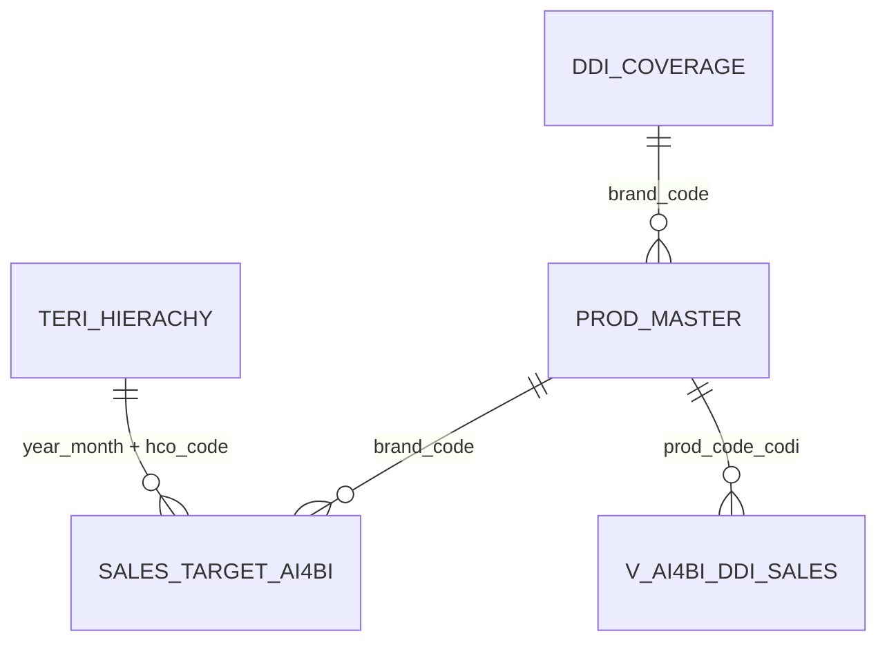

# 业务数据仓库表

## 1. 范围

| 表 | 对象类型 | 行数（约） | 列数 | 主要用途 |
| --- | --- | ---: | ---: | --- |
| `public.sales_target_ai4bi` | 物理表 | 1,221,372 | 34 | 月度实际销售与目标对比的核心事实表 |
| `public.v_ai4bi_ddi_sales` | 物理表（虽然名称带有 `v_` 前缀） | 8,783 | 38 | DDI 每日纯销交易明细 |
| `public.prod_master` | 物理表 | 16 | 28 | 产品 / 品牌 / 治疗领域主数据 |
| `public.teri_hierachy` | 物理表 | 447,717 | 27 | 医疗机构（HCO）与销售区域及人员层级关系的月度快照 |
| `public.ddi_coverage` | 物理表 | 11 | 4 | 品牌层面的 DDI 销量与覆盖系数 |
| `public.data_range_config` | 物理表 | 1 | - | 定义当前数据时间范围的单行控制表 |

## 2. 关联关系

| 左侧字段 | 右侧字段 | 含义 | 注意事项 |
| --- | --- | --- | --- |
| `sales_target_ai4bi.brand_code` | `prod_master.brand_code` | 销售事实关联品牌主数据 | 产品主数据中的 `brand_code` 不唯一；关联前需按品牌去重 |
| `v_ai4bi_ddi_sales.prod_code_codi` | `prod_master.prod_code_codi` | DDI 产品编码关联品牌 | 标准报表使用的产品关联桥梁 |
| `sales_target_ai4bi.year_month, hco_code` | `teri_hierachy.year_month, hco_code` | 事实数据关联同一月份的销售区域层级 | 还需按治疗领域（TA）/ 业务单元限定，避免多对多关联导致行数膨胀 |
| `ddi_coverage.brand_code` | `prod_master.brand_code` | DDI 覆盖系数关联品牌 | 两侧分别有 11 和 13 个不同的品牌编码；需核查未匹配的值 |

## 3. `public.sales_target_ai4bi`

### 3.1 业务含义

销售目标与达成情况的主要事实表，也是 Ask Data（数据问答）的底层物理数据源。面向大语言模型（LLM）的数据层必须使用逻辑数据集 `sales_target`，以保留行级权限公共表表达式（CTE）；直接引用物理表会被拒绝。

- 数据粒度：月份 + 医疗机构（HCO）+ 品牌 + 销售区域 + 数据粒度类型
- 月份范围：`202401` 至 `202609`
- `data_type` 的取值：`Daily`（日度）、`Monthly`（月度）

### 3.2 字段

| 字段 | 类型 | 是否允许为空 | 说明 |
| --- | --- | --- | --- |
| `year_month` | `integer` | 是 | 月份键，采用 `YYYYMM` 整数格式 |
| `hco_code` | `varchar(100)` | 是 | 医疗机构（HCO）编码 |
| `hco_name` | `varchar(200)` | 是 | 医疗机构（HCO）名称 |
| `teri_code` | `varchar(50)` | 是 | 区域销售代表（TS）的销售区域编码 |
| `sam_teri_code` | `varchar(20)` | 是 | SAM 层级的销售区域编码 |
| `rd_teri_code` | `varchar(20)` | 是 | RD / RSM 层级的销售区域编码 |
| `brand_code` | `varchar(200)` | 是 | 品牌编码 |
| `brand_name_cn` | `varchar(100)` | 是 | 品牌中文名称 |
| `brand_name_en` | `varchar(4000)` | 是 | 品牌英文名称 |
| `city_code` | `varchar(100)` | 是 | 城市编码 |
| `city_name_cn` | `varchar(100)` | 是 | 城市中文名称 |
| `province_code` | `varchar(50)` | 是 | 省份编码 |
| `province_name_cn` | `varchar(100)` | 是 | 省份中文名称 |
| `tier` | `varchar(500)` | 是 | 医疗机构（HCO）/ 客户等级 |
| `sales_qty` | `numeric(38,6)` | 是 | 实际销售数量；使用 `SUM` 汇总 |
| `sales_amt` | `numeric(38,6)` | 是 | 实际销售金额，单位为人民币（CNY）；使用 `SUM` 汇总 |
| `sales_amt_asp` | `numeric(38,6)` | 是 | 按 ASP 口径重算的实际金额（报表中以美元计） |
| `target_qty` | `numeric(38,6)` | 是 | 目标销售数量 |
| `target_amt` | `numeric(38,6)` | 是 | 目标销售金额，单位为人民币（CNY） |
| `target_amt_asp` | `numeric(38,6)` | 是 | 按 ASP 口径重算的目标金额（报表中以美元计） |
| `market_type_latest` | `varchar(20)` | 是 | 最新市场归属（核心市场、CSO、多渠道、DDI） |
| `terminal_type_latest` | `varchar(50)` | 是 | 最新终端类型（医院准入、药房、电商、互联网医院） |
| `terminal_channel_latest` | `varchar(100)` | 是 | 最新终端渠道 |
| `terminal_platform_latest` | `varchar(100)` | 是 | 最新终端平台 |
| `ts_name` | `varchar(20)` | 是 | TS 代表姓名 |
| `ts_adid` | `varchar(20)` | 是 | TS 代表的 AD 账户 ID |
| `sam_name` | `varchar(20)` | 是 | SAM 姓名 |
| `sam_adid` | `varchar(20)` | 是 | SAM 的 AD 账户 ID |
| `rd_name` | `varchar(20)` | 是 | RD / RSM 姓名 |
| `rd_adid` | `varchar(20)` | 是 | RD / RSM 的 AD 账户 ID |
| `region` | `varchar(50)` | 是 | 销售大区 |
| `data_type` | `varchar(7)` | **否** | 数据粒度类型：`Daily`（日度）或 `Monthly`（月度） |
| `ta` | `varchar(200)` | 是 | 治疗领域 |
| `bu` | `varchar(20)` | 是 | 业务单元 |

### 3.3 派生指标

- 金额达成率：`SUM(sales_amt) / NULLIF(SUM(target_amt), 0)`
- 数量达成率：`SUM(sales_qty) / NULLIF(SUM(target_qty), 0)`
- ASP / 美元口径达成率：`SUM(sales_amt_asp) / NULLIF(SUM(target_amt_asp), 0)`

不要将 `Daily` 和 `Monthly` 数据行混合汇总，否则会重复计数。

## 4. `public.v_ai4bi_ddi_sales`

### 4.1 业务含义

DDI 每日纯销交易明细，用于标准报表的 `By Date`（按日期）维度。

- 数据粒度：接近销售记录 / 产品 / 上下游客户 / 日期层级
- 当前数据覆盖范围：`2026-09-01` 至 `2026-09-03`
- `data_type` 始终为 `Daily`；`sales_type` 始终为纯销
- 8,783 行数据中，`sales_id` 有 7,989 个不同值，因此它不是唯一键

### 4.2 字段

| 字段 | 类型 | 说明 |
| --- | --- | --- |
| `id` | `bigint` | 内部记录 ID；未声明主键 |
| `sales_id` | `varchar(100)` | 业务销售记录 ID；不唯一 |
| `sales_date` | `date` | 销售日期 |
| `year_month` | `integer` | 销售月份，采用 `YYYYMM` 格式 |
| `upstream_code` | `varchar(100)` | 上游客户内部编码 |
| `upstream_extr_code` | `varchar(100)` | 上游客户外部编码 |
| `downstream_code` | `varchar(100)` | 下游客户内部编码 |
| `downstream_extr_code` | `varchar(100)` | 下游客户外部编码 |
| `affiliate_hco_code` | `varchar(100)` | 关联医疗机构（HCO）编码；报表中用于限定权限范围的字段 |
| `prod_code_codi` | `varchar(100)` | CODI 产品编码；与 `prod_master` 关联的键 |
| `prod_code` | `varchar(100)` | 内部产品编码 |
| `sales_qty` | `numeric(16,4)` | 销售数量 |
| `data_channel` | `varchar(100)` | 数据渠道 |
| `upstream_level` | `varchar(100)` | 上游客户层级 |
| `downstream_level` | `varchar(100)` | 下游客户层级 |
| `downstream_is_special_flag` | `integer` | 特殊下游客户标识 |
| `price_hist` | `numeric(16,4)` | 历史价格 |
| `special_price_hist` | `numeric(16,4)` | 历史特殊价格 |
| `standard_price_hist` | `numeric(16,4)` | 历史标准价格 |
| `price_latest` | `numeric(16,4)` | 最新价格；用于计算人民币金额 |
| `daily_date_version` | `date` | 日度数据版本日期 |
| `market_type` | `varchar(255)` | 历史 / 原始市场归属 |
| `terminal_type` | `varchar(255)` | 历史 / 原始终端类型 |
| `terminal_channel` | `varchar(255)` | 历史 / 原始终端渠道 |
| `terminal_platform` | `varchar(100)` | 历史 / 原始终端平台 |
| `market_type_latest` | `varchar(20)` | 最新市场归属 |
| `terminal_type_latest` | `varchar(50)` | 最新终端类型 |
| `terminal_channel_latest` | `varchar(100)` | 最新终端渠道 |
| `terminal_platform_latest` | `varchar(100)` | 最新终端平台 |
| `channel_source` | `varchar(255)` | 渠道来源；当前全部为空 |
| `data_type` | `varchar(255)` | 数据粒度类型；当前为 `Daily` |
| `sales_type` | `varchar(50)` | 销售类型；当前仅有纯销 |
| `from_cust_bizlevel` | `varchar(100)` | 上游客户业务层级 |
| `to_cust_bizlevel` | `varchar(100)` | 下游客户业务层级 |
| `from_cust_org_type1` | `varchar(100)` | 上游客户的第1级组织类型 |
| `codi_rec_id` | `bigint` | CODI 中的源记录 ID |
| `asp_price` | `numeric(16,2)` | ASP 价格；美元金额为 `sales_qty * asp_price` |
| `brand_name_cn` | `varchar(20)` | 品牌中文名称；报表仍通过 `prod_master` 确定品牌编码 |

金额计算口径：人民币（CNY）= `SUM(sales_qty * price_latest)`，美元（USD）= `SUM(sales_qty * asp_price)`。

## 5. `public.prod_master`

### 5.1 业务含义

产品主数据用于建立内部产品编码、CODI 产品编码、品牌和治疗领域之间的映射关系。共有 16 行，其中 `prod_code` 有 16 个不同值，`prod_code_codi` 有 16 个不同值，`brand_code` 有 13 个不同值，`ta_code` 有 6 个不同值；产品编码在实际数据中唯一，品牌编码不唯一。

### 5.2 字段

| 字段 | 类型 | 说明 |
| --- | --- | --- |
| `prod_code` | `varchar(100)` | 内部产品编码；候选业务键 |
| `prod_code_codi` | `varchar(100)` | CODI 产品编码；关联 DDI 明细的桥接键 |
| `prod_name_cn`, `prod_name_en` | `varchar(200)` | 产品名称（中文 / 英文） |
| `prod_alias` | `varchar(200)` | 产品别名 |
| `chemical_name` | `varchar(100)` | 化学名称 |
| `generic_name` | `varchar(100)` | 通用名称 |
| `brand_code` | `varchar(200)` | 品牌编码；一个品牌可能对应多个产品 / 规格 |
| `brand_name_cn`, `brand_name_en` | `varchar(100)` | 品牌名称（中文 / 英文） |
| `dosage_forms` | `varchar(200)` | 剂型 |
| `origin_place` | `varchar(200)` | 原产国 / 产地 |
| `cold_chain_flag` | `integer` | 冷链标识 |
| `pkg_type`, `pkg_size` | `varchar(200)` | 包装类型和包装规格 |
| `min_unit`, `min_unit_size` | `varchar(200)` | 最小单位和单位规格 |
| `prod_imgurl` | `varchar(200)` | 产品图片网址 |
| `manufacturer`, `manufacturer_addr` | `varchar(200)` | 生产商及其地址 |
| `specification` | `varchar(200)` | 产品规格 |
| `license_issue_flag` | `integer` | 注册 / 许可证状态标识 |
| `license_num` | `varchar(200)` | 注册 / 许可证编号 |
| `license_eff_date`, `license_exp_date` | `timestamp` | 许可证生效和到期时间戳 |
| `ta_code` | `varchar(100)` | 治疗领域编码 |
| `ta_name_cn`, `ta_name_en` | `varchar(200)` | 治疗领域名称（中文 / 英文） |

## 6. `public.teri_hierachy`

### 6.1 业务含义

销售区域层级的月度快照，将医疗机构（HCO）、地理信息和治疗领域（TA）/ 业务单元（BU）关联到四个销售区域层级（TS、ASM、RSM、SD）及其负责人。月份范围为 `202101` 至 `203603`，且**包含未来月份**：历史归属应使用业务月份，权限应使用系统定义的当前生效月份。

表名中的 `hierachy` 是数据库中的实际拼写，请勿在 SQL 中将其“纠正”为 `hierarchy`。

### 6.2 字段

| 字段 | 类型 | 说明 |
| --- | --- | --- |
| `year_month` | `integer` | 月度快照键，采用 `YYYYMM` 格式 |
| `hco_code`, `hco_name_cn` | `varchar(200)` | 医疗机构（HCO）编码及中文名称 |
| `province_name_cn`, `province_code` | `varchar(500)` | 省份名称和编码 |
| `city_name_cn`, `city_code` | `varchar(500)` | 城市名称和编码 |
| `ta` | `varchar(50)` | 治疗领域 |
| `teri_ta` | `varchar(200)` | 销售区域侧的治疗领域（TA）分类 |
| `ts_teri_code`, `ts_teri_name` | `varchar(20)`, `varchar(50)` | TS 销售区域编码和名称 |
| `ts_empl_name`, `ts_empl_adid` | `varchar(20)` | TS 负责人姓名和 AD 账户 ID |
| `asm_lvl_teri_code`, `asm_lvl_teri_name` | `varchar(20)`, `varchar(50)` | ASM 层级的销售区域编码和名称 |
| `asm_lvl_empl_name`, `asm_lvl_empl_adid` | `varchar(20)` | ASM 负责人姓名和 AD 账户 ID |
| `rsm_lvl_teri_code`, `rsm_lvl_teri_name` | `varchar(20)`, `varchar(50)` | RSM / RD 层级的销售区域编码和名称 |
| `rsm_lvl_empl_name`, `rsm_lvl_empl_adid` | `varchar(20)` | RSM / RD 负责人姓名和 AD 账户 ID |
| `sd_lvl_teri_code`, `sd_lvl_teri_name` | `varchar(20)`, `varchar(50)` | SD 层级的销售区域编码和名称 |
| `sd_lvl_empl_name`, `sd_lvl_empl_adid` | `varchar(20)` | SD 负责人姓名和 AD 账户 ID |
| `tier` | `varchar(20)` | 医疗机构（HCO）/ 客户等级 |
| `bu` | `varchar(20)` | 业务单元 |

## 7. `public.ddi_coverage`

品牌层面的 DDI 覆盖参数。共有 11 行，`brand_code` 有 11 个不同值，因此它可作为候选业务键，但数据库未强制实施唯一性约束。

| 字段 | 类型 | 说明 |
| --- | --- | --- |
| `brand_code` | `varchar(200)` | 品牌编码 |
| `sales_qty_daily` | `numeric(38,8)` | 日度销售数量 |
| `sales_qty_monthly` | `numeric(38,4)` | 月度销售数量 |
| `coverage` | `numeric(38,6)` | 覆盖比例 / 缩放系数；观测到的范围约为 `0.114583` 至 `1.004446` |

`coverage` 可能略大于 1。未经业务确认，不要将其强制限制在 `[0, 1]` 范围内。

## 8. `public.data_range_config`

用于定义当前报表数据时间范围的单行控制表。标准报表构建器和权限批次编译器会读取此表，以确定“当前数据范围”。

| 字段 | 类型 | 说明 |
| --- | --- | --- |
| `max_daily_yearmonth` | 兼容整数的类型 | 最近已结算月份，采用 `YYYYMM` 格式；用作权限批次的快照月份以及销售区域层级的月份筛选条件 |
| `max_ddi_version` | 可转换为日期的文本 | 最新 DDI 销售日期；转换为 `DATE` 类型后用于标准报表的 `By Date`（按日期）维度 |
